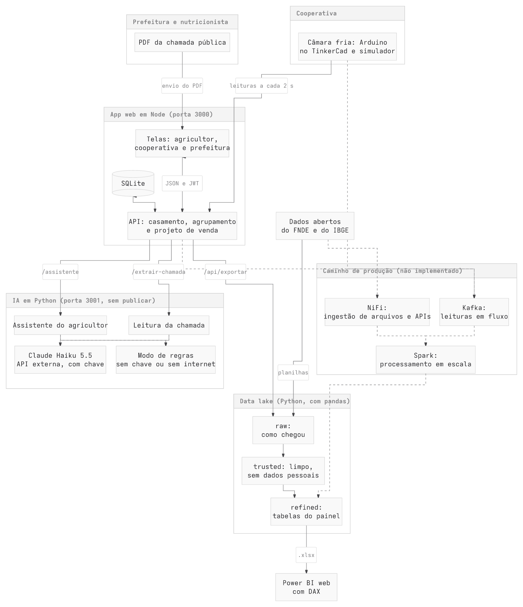

# Merenda do Vizinho

MVP da FIAP Global Solution que ajuda agricultores familiares a vender alimentos para a merenda escolar (PNAE).

- **Curso:** Global Solution 2026/2, CitizenTech (FIAP)
- **Integrantes:** _(preencher)_
- **Entrega:** o PDF de evidências (`entrega/evidencias.pdf`) e o `.txt` do grupo (`entrega/grupo.txt`) estão na pasta [entrega/](entrega/).

## O que é, para quem e qual problema resolve

O PNAE compra a merenda das escolas públicas. Desde 1º de janeiro de 2026, pelo menos 45% da verba do programa tem de ser comprada da agricultura familiar (Lei 15.226/2025). Até 2025 eram 30%. Mesmo assim, muitas prefeituras não chegam ao mínimo: em 2022, 1.531 delas ficaram abaixo dos 30% da época, e faltaram R$ 97,1 milhões para chegarem lá (contas do grupo sobre as planilhas do FNDE, com dados preliminares).

A **Merenda do Vizinho** é um serviço web para a cidade:

- a **prefeitura** envia o PDF da chamada pública, e a IA (Claude) lê os itens, as quantidades, os preços e os prazos;
- o **agricultor** vê as chamadas que pode atender e quanto pode ganhar, e um assistente explica o edital em linguagem simples, com botão "Ouvir";
- a **cooperativa** junta os vizinhos para fechar o volume pedido e gera o projeto de venda no modelo do FNDE;
- uma **câmara fria simulada** (Arduino no TinkerCad e simulador em Python) avisa quando a temperatura ou a porta saem do normal;
- um **painel no Power BI** mostra, com dados reais do FNDE até 2022, quais prefeituras ficaram abaixo do mínimo e quanto faltou.

**Para quem:** o agricultor familiar, a cooperativa da cidade, a prefeitura (secretaria de educação, nutricionista e Conselho de Alimentação Escolar).

**O problema:** o agricultor muitas vezes não sabe da chamada, não entende o edital em PDF, não monta o projeto de venda ou produz pouco para o volume pedido. A cooperativa divide o pedido à mão. A prefeitura só descobre se cumpriu o mínimo quando o ano fecha.

**O que não é:** não substitui o Contrata+Brasil, a plataforma federal, nem a decisão da prefeitura. Sem chamada publicada, não há oportunidade. A câmara fria e o histórico de entregas são simulados; as chamadas e os dados do FNDE e do IBGE são reais.

## Arquitetura



São quatro módulos num repositório só, com contratos simples (HTTP em JSON e arquivos). Cada um roda sozinho, seguindo este README.

| Módulo | Pasta | Tecnologia | Porta |
|:--|:--|:--|:--|
| App (API e telas) | `app/` | Node 24, módulo `http` nativo, SQLite, telas em Svelte 5 com Vite | 3000 |
| IA | `ia/` | Python 3.12 ou mais novo, `http.server`, SDK `anthropic`, `pypdf` | 3001 (não publicada no Docker) |
| Data lake | `dados/` | Python, pandas e openpyxl | sem porta (tarefa) |
| Câmara fria | `iot/` | Arduino Uno no TinkerCad e simulador em Python, só biblioteca padrão | sem porta (tarefa) |

O diagrama, os contratos entre os módulos e o caminho de produção estão em [docs/arquitetura.md](docs/arquitetura.md).

**Caminho de produção (Kafka, NiFi e Spark): não implementado.** Está desenhado no diagrama, tracejado, para mostrar onde a ingestão entraria em escala. No MVP, o pipeline em Python faz esse caminho.

**Conexão com o curso.** O edital pede o conteúdo do curso até a fase 7. O Claude é conteúdo do curso: aparece na F4C07 (seção 4.6) e na F1C08. A chamada à IA segue o padrão da F7C07, em que um cliente de LLM em Python manda o pedido e recebe a resposta. No projeto, esse cliente é o SDK da Anthropic, no lugar do da OpenAI que o curso usa, e o curso não ensina o SDK da Anthropic. Por isso o modo de regras, em Python com `pypdf`, funciona sem o Claude. **Svelte 5 e Vite nas telas** são a exceção declarada do grupo: escolha do grupo, fora do conteúdo do curso. O mapa de cada tecnologia para um capítulo do curso está em [docs/conexao-com-o-curso.md](docs/conexao-com-o-curso.md).

### Privacidade

- A IA **nunca** recebe os dados cadastrados do agricultor: nome, CPF, CAF, e-mail, telefone, dados bancários nem os critérios do RITS (mulher, jovem, assentado, indígena, quilombola). Do perfil vão só os produtos e as quantidades, os meses de safra, o município, a UF, se a produção é orgânica e se há prioridade no RITS (sim ou não).
- No chat do assistente, o serviço recusa (erro 400) CPF, e-mail, telefone e dados bancários que o agricultor digitar. A tela pede para não escrever o nome: um nome digitado não dá para detectar.
- O data lake recebe os agricultores só com pseudônimo (12 caracteres, HMAC-SHA256 do id). Nome, CPF, CAF e e-mail não chegam à camada trusted; o teste confere isso com uma exportação de controle que traz esses dados.
- As telas mostram CPF e CAF mascarados. O projeto de venda também mostra os dois com máscara: o agricultor escreve os números completos à mão, porque o modelo do FNDE pede esses dados.

## Pré-requisitos

- **Git** (opcional), só para clonar o repositório: o `.zip` já traz o código e a pasta `.git`.
- **Internet na primeira execução:** o Docker baixa as imagens e, sem Docker, o `npm ci` e o `pip install` baixam os pacotes.
- **Para rodar com Docker:** Docker com o plugin Compose (testado com Docker 29.9 e Compose 5.7), ou **Podman sem root** com `podman-compose` (testado com Podman 6.2 e podman-compose 1.6).
- **Para rodar sem Docker:** Node.js 24 ou mais novo (o app pede a versão 24 ou mais nova) e Python 3.12 ou mais novo (testado com 3.12 e 3.14).
- **Chave da API da Anthropic (opcional):** sem ela, o app roda no **modo de regras**: a leitura do PDF e o assistente funcionam sem IA, com regras fixas. Com a chave, a leitura e o assistente usam o Claude Haiku 5.5.
- Os comandos abaixo são de bash, em Linux (ou WSL, no Windows). Foram testados em Linux.

## Como rodar (com Docker e sem Docker)

Primeiro, pegue o código e entre na pasta dele, a que tem o `README.md` e o `docker-compose.yml`. Os comandos abaixo valem a partir dela.

**Se você recebeu o `.zip`:** descompacte e entre na pasta `merenda-do-vizinho`.

```bash
unzip merenda-do-vizinho.zip
cd merenda-do-vizinho
```

**Se for pelo Git:** use o endereço HTTPS, que não pede chave SSH. A versão final está na `main`.

```bash
git clone https://github.com/FIAP-grupo-challenge/merenda-do-vizinho-gs.git
cd merenda-do-vizinho-gs
git checkout main
```

Os dois caminhos começam pelo `.env`.

### 1. Criar o `.env` (os dois caminhos)

O `.env` guarda os segredos. Ele não vai para o Git nem para o `.zip`. Crie-o na raiz do repositório:

```bash
cat > .env <<EOF
ANTHROPIC_API_KEY=
JWT_SEGREDO=$(openssl rand -hex 32)
CHAVE_SERVICO=$(openssl rand -hex 32)
CHAVE_DISPOSITIVO=$(openssl rand -hex 32)
DATA_REFERENCIA=2026-07-15
EOF
chmod 600 .env
```

Rode esse bloco só se ainda não existe `.env`: ele cria o arquivo do zero. Sem o `openssl`, troque cada `$(openssl rand -hex 32)` por `$(python3 -c 'import secrets; print(secrets.token_hex(32))')`.

Outro jeito é copiar o modelo, `cp .env.example .env`, e editar. O modelo traz os três segredos como `troque-este-valor` (troque cada um por um valor aleatório, como os que o bloco gera: o app não sobe com o texto de exemplo nem com um segredo de menos de 16 caracteres) e a `DATA_REFERENCIA=2026-07-15` já preenchida (o motivo está em "Usuários de demonstração e data de referência"). Se o `.env` já existe, abra-o num editor e confira esses mesmos pontos.

Para usar a IA com o Claude, cole a chave da API em `ANTHROPIC_API_KEY=`. Sem a chave, tudo funciona no modo de regras.

| Variável | Obrigatória | Para quê | Padrão |
|:--|:--|:--|:--|
| `JWT_SEGREDO` | sim | assina o login (JWT) e o pseudônimo do data lake | não tem: o app não sobe sem ele |
| `CHAVE_SERVICO` | sim | o pipeline de dados lê a exportação do app com ela | não tem |
| `CHAVE_DISPOSITIVO` | sim | a câmara fria (Arduino ou simulador) envia as leituras com ela | não tem |
| `ANTHROPIC_API_KEY` | não | chave da API da Anthropic; sem ela, o modo de regras | vazia |
| `DATA_REFERENCIA` | não, mas a demonstração usa `2026-07-15` | o "hoje" das oportunidades, no formato AAAA-MM-DD | a data de hoje |
| `SEMANAS_PADRAO` | não | semanas de entrega quando a chamada não diz (vale para o app e para a IA) | 40, de `compartilhado/regras-pnae.json`. Com um valor que não é número maior que zero, o app não sobe; a IA só registra um aviso |
| `MODELO_CLAUDE` | não | modelo da IA | `claude-haiku-5-5` |
| `LIMITE_TEMP_C` | não | temperatura que dispara o alerta da câmara fria | 10 |
| `MINUTOS_PORTA_ABERTA` | não | minutos com a porta aberta que disparam o alerta | 2 |

Os três segredos precisam ter pelo menos 16 caracteres, e o `troque-este-valor` do modelo não vale: o app diz qual variável trocar e não sobe.

### 2A. Com Docker

Com o `.env` pronto, na raiz do repositório:

```bash
docker compose up --build
```

Deixe esse terminal aberto (a primeira vez demora, porque o Docker baixa as imagens e monta tudo). Em outro terminal, confira que os dois serviços estão `healthy`:

```bash
docker compose ps
```

Abra **http://localhost:3000**. O app sobe junto com a IA, que roda na rede interna do Compose e **não** fica publicada no seu computador. Isso é de propósito: a IA não tem login e gasta a sua chave da API.

Para ver o modo da IA (`regras` ou `ia`) sem publicar a porta:

```bash
docker compose exec -T ia python -c "import urllib.request; print(urllib.request.urlopen('http://127.0.0.1:3001/saude').read().decode())"
```

Saída esperada: `{"ok": true, "modo": "regras"}`. Com a chave no `.env`, `"modo": "ia"`.

Para parar: `docker compose down` (mantém o banco). Para apagar o banco e recriar a demonstração do zero: `docker compose down -v`.

**Tarefas** (rodam uma vez, com o app no ar; o perfil `tarefas` é o que mantém o simulador e o pipeline fora do `up`):

```bash
# câmara fria: 15 leituras com a porta aberta, a temperatura sobe e passa de 10 °C na 14ª
docker compose --profile tarefas run --rm iot python iot/simulador.py --cenario porta-aberta --quantidade 15 --intervalo 1 --url http://app:3000/api/leituras

# data lake: o pipeline com a cópia versionada das fontes públicas e os dados do app
docker compose --profile tarefas run --rm -e PIPELINE_OFFLINE=1 dados
```

**Teste de fumaça:** `devops/smoke.sh` sobe o app e a IA num projeto Compose próprio (`merenda-smoke`), confere os dois, faz uma pergunta ao assistente como a Ana (o app chama a IA e a resposta volta), manda leituras, roda o pipeline, derruba a pilha e imprime `SMOKE OK`. Se o `.env` não existir, ele cria um de teste, com segredos aleatórios, `DATA_REFERENCIA=2026-07-15` e sem chave da API.

O app do smoke também quer a porta 3000 do computador. Com a pilha do `docker compose up` ainda no ar, o smoke falha com `Bind for 0.0.0.0:3000 failed: port is already allocated`. Há dois jeitos de evitar isso. O primeiro é parar a pilha antes (o banco fica guardado):

```bash
docker compose down
bash devops/smoke.sh
```

O segundo é deixar a pilha no ar e pedir ao Docker uma porta livre qualquer para o app do smoke, com `PORTA_APP=0` (o smoke fala com o app pela rede do Compose, e não pela porta do computador; testado com Docker):

```bash
PORTA_APP=0 bash devops/smoke.sh
```

O `bash` na frente vale mesmo que o `.zip` tenha perdido a permissão de execução do script.

**Com Podman sem root**, use o `podman-compose` com a opção que faz o usuário 1000 do contêiner ser você:

```bash
COMPOSE="podman-compose --podman-run-args=--userns=keep-id:uid=1000,gid=1000"
$COMPOSE up --build
```

Sem essa opção, o pipeline não grava em `./dados/datalake`. O mesmo vale para o smoke: `COMPOSE="podman-compose --podman-run-args=--userns=keep-id:uid=1000,gid=1000" bash devops/smoke.sh`. Nas tarefas, use o mesmo `$COMPOSE` no lugar de `docker compose`, sempre com `--profile tarefas` (o `podman-compose` só roda um serviço de perfil com o perfil ligado).

**No Linux, com um usuário que não é o uid 1000** (confira com `id -u`): os contêineres gravam como uid 1000. Sem permissão, o pipeline falha com `PermissionError` ao gravar em `./dados/datalake`. Dê a permissão com o comando abaixo (se a pasta não for sua, ponha `sudo` na frente):

```bash
chmod -R a+rwX dados/datalake
```

### 2B. Sem Docker

Na raiz do repositório, uma vez (precisa de internet: baixa os pacotes do Python e do Node):

```bash
python3 -m venv .venv
.venv/bin/pip install -r ia/requirements.txt -r dados/requirements.txt
(cd app && npm ci)
```

No Ubuntu e no Debian, o `python3 -m venv` precisa do pacote `python3-venv` (`sudo apt install python3-venv`); sem ele, o comando falha com a mensagem `ensurepip is not available`.

Cada terminal que roda as partes em Python precisa carregar o `.env` no shell primeiro (o app já lê o `.env` sozinho, mas o simulador e os scripts Python não):

```bash
set -a; . ./.env; set +a
```

Abra um terminal para cada parte. Cada terminal começa na pasta em que você o abriu: entre na raiz do repositório (a pasta do `README.md`) antes de rodar os comandos abaixo.

**Terminal 1, o app** (o `npm start` gera as telas com Vite antes de subir, em `app/public/`):

```bash
set -a; . ./.env; set +a
cd app
npm start
```

Saída esperada: `Merenda do Vizinho em http://localhost:3000`. Abra essa página no navegador.

**Terminal 2, a IA:**

```bash
set -a; . ./.env; set +a
.venv/bin/python -m ia.servidor
```

Saída esperada: `IA na porta 3001, modo regras` (ou `modo ia`, com a chave no `.env`).

**Cuidado:** sem Docker, a IA escuta em todas as interfaces do computador e não tem login (no Docker ela não é publicada). Quem alcança a porta 3001 pela rede usa a IA e, com a chave no `.env`, gasta a sua chave. Rode essa parte numa máquina de confiança, fora de redes abertas.

**Terminal 3, a câmara fria e o pipeline** (com o app no ar):

```bash
set -a; . ./.env; set +a
python3 iot/simulador.py --cenario porta-aberta --quantidade 15 --intervalo 1
PIPELINE_OFFLINE=1 .venv/bin/python -m dados.pipeline tudo
```

Para parar, aperte `Ctrl+C` em cada terminal.

**Se algo não sobe** (vale para os dois caminhos):

- `EADDRINUSE` ou "porta em uso": outro programa usa a porta 3000 ou 3001. Feche esse programa e rode o comando de novo.
- `port is already allocated` ao subir com Docker: outro programa usa a porta 3000. Feche-o, ou suba o app em outra porta, como `PORTA_APP=3100 docker compose up --build`, e abra http://localhost:3100. As tarefas da seção 2A não mudam: elas falam com o app pela rede do Compose.
- `falta JWT_SEGREDO no .env` (ou outra chave): o `.env` não tem o segredo, ou não está na raiz. Confira com `cat .env`, sem colar o conteúdo em lugar nenhum.
- `JWT_SEGREDO no .env é o texto de exemplo ... ou tem menos de 16 caracteres` (ou outra chave): o segredo ainda é o `troque-este-valor` do `.env.example`, ou é curto demais. Troque por um valor aleatório, como o do bloco da seção 1 (`openssl rand -hex 32`).
- `SEMANAS_PADRAO deve ser um número maior que zero`: a variável tem um valor inválido. Apague a linha ou ponha um número, como `40`.
- `npm: command not found` ou `engines`: instale o Node.js 24 ou mais novo.

## Usuários de demonstração e data de referência

A senha de **todos** os usuários de demonstração é `demo1234`. Eles são fictícios e estão todos em Catalão (GO), a cidade da chamada de demonstração:

| Papel | E-mail | Quem é | O que planta |
|:--|:--|:--|:--|
| Prefeitura | `prefeitura@demo.br` | Prefeitura Municipal de Catalão | publica a chamada 003/2026 |
| Cooperativa | `cooperativa@demo.br` | Cooperativa Vizinhos do Campo | junta os cooperados e gera a proposta |
| Agricultor | `ana@demo.br` | Ana Souza | alface e mandioca (a usuária da demonstração) |
| Agricultor | `bruno@demo.br` | Bruno Lima | tomate e pepino; já vendeu ao PNAE |
| Agricultor | `carla@demo.br` | Carla Ferreira | alface, couve e cheiro-verde |
| Agricultor | `davi@demo.br` | Davi Rocha | mandioca, milho-verde e abóbora |
| Agricultor | `elisa@demo.br` | Elisa Martins | brócolis, couve-flor e alface |
| Agricultor | `fabio@demo.br` | Fábio Alves | alface e mandioca; já vendeu R$ 38 mil no ano, perto do limite de R$ 40 mil |

Os seis agricultores são cooperados da cooperativa de demonstração. A cada subida do app, a semente cria os usuários que faltam (os que já existem não são mexidos) e publica a chamada de Catalão, já lida, com o interesse dos agricultores. Essa leitura (`app/semente/chamada-demo.json`) começou de uma extração do Claude, e um agente de IA conferiu os 16 itens contra o PDF e ajustou alguns campos de texto. Para recomeçar do zero: `docker compose down -v` (com Docker) ou apague `app/merenda.db` (sem Docker).

**Por que `DATA_REFERENCIA=2026-07-15`.** A chamada pública de Catalão (nº 003/2026) recebeu projetos de 09/07 a 30/07/2026 e já fechou. O app mostra como oportunidades só as chamadas com prazo a partir da data de referência, que é o "hoje" dele. Sem essa data, o app usa a data do computador, a chamada aparece como encerrada, e a agricultora de demonstração (Ana) não vê nenhuma oportunidade. Por isso o bloco da seção 1 e o `.env.example` já trazem `DATA_REFERENCIA=2026-07-15`. Para usar a data de hoje, como num uso de verdade, deixe a variável vazia.

## Como rodar cada área e o que deve aparecer

Os passos abaixo valem com ou sem Docker. Onde o comando muda, a diferença está escrita.

### App: prefeitura, cooperativa e agricultor

Abra http://localhost:3000 e entre com um dos usuários acima (aba "Entrar"; a aba "Criar conta" faz um cadastro novo).

1. **Prefeitura** (`prefeitura@demo.br`), tela **Chamadas**. Em "Suas chamadas" aparece a chamada 003/2026 de Catalão, **publicada**. Para ver a leitura da IA, em "Nova chamada" escolha o PDF `ia/avaliacao/chamadas/04-go-catalao-2026.pdf` e toque em **Ler o PDF**. Aparece a tabela com os 16 itens da chamada e a origem da leitura (`regras` sem chave, `ia` com chave). A leitura vira um rascunho; não é preciso publicar, porque a chamada de Catalão já está publicada.

2. **Agricultora** (`ana@demo.br`), tela **Chamadas abertas para você**. Aparece o cartão da chamada de Catalão, com o selo "Na sua cidade: quem é da cidade tem prioridade", **"Você pode ganhar até R$ 21.082,00"** e, em cada item que ela planta, o que a prefeitura pede (alface: 2.280 pç; mandioca: 2.800 kg). O cartão diz até quando entregar o projeto de venda (30/07/2026). O aviso "Seleção anterior, sem RITS" aparece porque o edital saiu até 22/10/2026. Toque em **Ver a chamada e o assistente**: a tela da chamada tem o **assistente**. Escreva, por exemplo, `Posso entregar 50 de alface por semana?` e toque em **Enviar**. A resposta diz quanto dá (2.000 pç em 40 semanas) e lista os documentos. Sem chave, a resposta vem do roteiro (origem `regras`). O botão **Quero participar** grava o interesse dela para a cooperativa.

3. **Cooperativa** (`cooperativa@demo.br`), tela **Cooperativa**. Em "Chamadas abertas no seu estado", toque em **Montar a proposta conjunta** na chamada de Catalão. Aparece a **proposta conjunta**: cada item dividido entre os cooperados que o produzem (por exemplo, a alface entre Ana, Carla, Elisa e Fábio), o que falta em cada item e o total. Itens que nenhum cooperado produz (alho, batata, cebola, pão e biscoito) ficam com o pedido inteiro como falta. Depois, **Salvar a divisão** grava uma edição, e **Gerar projeto de venda** abre o projeto no modelo do FNDE, com **Imprimir**.

4. **Câmara fria** (cooperativa), tela **Câmara fria**. Com o simulador rodando (veja abaixo), aparece a faixa vermelha **"Alerta na câmara fria"** com a mensagem `Temperatura de 10,2 °C em camara-01, acima do limite de 10 °C.`

### IA: a leitura da chamada sem chave

Com a IA no ar, este script manda o PDF de Catalão para `/extrair-chamada` e imprime a chamada extraída. Sem Docker, rode da raiz do repositório:

```bash
.venv/bin/python - <<'EOF'
import base64, json, urllib.request

pdf = base64.b64encode(open('ia/avaliacao/chamadas/04-go-catalao-2026.pdf', 'rb').read()).decode()
pedido = urllib.request.Request('http://localhost:3001/extrair-chamada',
                                data=json.dumps({'pdf_base64': pdf}).encode(),
                                headers={'Content-Type': 'application/json'})
print(json.dumps(json.load(urllib.request.urlopen(pedido, timeout=120)), ensure_ascii=False, indent=2))
EOF
```

Com Docker, o mesmo script roda dentro do contêiner da IA, onde a porta 3001 está acessível: troque `.venv/bin/python -` por `docker compose exec -T ia python -`.

O PDF de entrada é o edital real de Catalão, com 15 páginas. Trecho da página 2, com as descrições cortadas (`…`) e os valores exatamente como estão no PDF:

```text
  1   Abóbora Cabotiá: de boa qualidade, firme e …   Unidade   390     R$ 7,00   R$ 2.730,00
  2   Abóbora verde: de boa qualidade, firme e …     Kg        1.640   R$ 6,87   R$ 11.266,80
```

A saída, com a IA desligada (`origem` = `regras`), traz a chamada e os itens. Trecho, com os campos nulos omitidos (`entrega` e `observacoes`, que cada item traz) e só os 3 primeiros dos 16 itens. O `duracao_ms` muda a cada execução.

```json
{
  "origem": "regras",
  "modelo": null,
  "duracao_ms": 364,
  "chamada": {
    "numero": "003/2026",
    "orgao": "Prefeitura Municipal de Catalão",
    "municipio": "Catalão",
    "uf": "GO",
    "data_publicacao": null,
    "prazo_envio": "2026-07-30",
    "periodo_fornecimento": null,
    "semanas_fornecimento": null,
    "local_entrega": null,
    "documentos_exigidos": [],
    "criterios_prioridade": [],
    "contato": null,
    "itens": [
      {"produto": "Abóbora Cabotiá", "produto_id": "abobora", "unidade": "unidade", "quantidade": 390.0, "preco_unitario": 7.0, "valor_total": null},
      {"produto": "Abóbora verde", "produto_id": "abobora", "unidade": "kg", "quantidade": 1640.0, "preco_unitario": 6.87, "valor_total": null},
      {"produto": "Alface", "produto_id": "alface", "unidade": "pç", "quantidade": 2280.0, "preco_unitario": 7.03, "valor_total": 16028.4}
    ]
  },
  "avisos": []
}
```

O que mostrar com atenção:

- O modo de regras acerta o número, o município, a UF, o prazo e os 16 itens com quantidade e preço. O `produto_id` vem do catálogo (`identificar_produto`).
- Nesse modo, a data de publicação, o período, o local, os documentos e os critérios saem vazios. Com a chave, o Claude lê esses campos quando o edital os traz.
- O `valor_total` de duas linhas (as abóboras) sai vazio, embora o edital tenha o valor. É uma falha conhecida da regra de tabela.
- Com a chave no `.env`, a mesma chamada devolve `"origem": "ia"` e `"modelo": "claude-haiku-5-5"`.

Para o assistente sem IA, veja a tela da agricultora acima: a pergunta sobre alface responde pelo roteiro, com a sugestão e a lista de documentos. Uma mensagem com e-mail, CPF ou telefone é recusada com erro 400.

### Data lake e painel

O pipeline (`dados/`) junta as fontes públicas do FNDE e do IBGE, a exportação do app e um histórico simulado, nas camadas **raw**, **trusted** e **refined**. Com `PIPELINE_OFFLINE=1` ele usa a cópia das fontes que está no repositório. Sem essa variável, ele baixa as planilhas de novo: se a fonte tiver mudado, o arquivo versionado muda, e o `git status` mostra.

A saída do comando termina com o resumo por camada (os números mudam com os dados do app). Trecho do teste de 19/11/2026:

```text
info: etapa baixar-fontes
aviso: PIPELINE_OFFLINE=1: usando a cópia versionada das fontes públicas
...
Resumo do data lake (linhas por camada):
raw: 142.816 linhas em 9 arquivos
trusted: 141.863 linhas em 6 arquivos
refined: 42.210 linhas em 6 arquivos
  fato_pnae_af.csv: 26.942
  fato_camara_fria.csv: 8.761
  ...
refined/merenda_do_vizinho.xlsx: abas fato_pnae_af, fato_repasse_uf, fato_entregas, fato_camara_fria, dim_produto, dim_municipio
```

Os arquivos ficam em `dados/datalake/` (as camadas, fora do Git, exceto as fontes públicas). A planilha `refined/merenda_do_vizinho.xlsx` é a entrada do painel. O passo a passo do painel no Power BI web está em [dados/powerbi/guia-do-painel.md](dados/powerbi/guia-do-painel.md). Os números de conferência de 2022 são 44,5% de compra da agricultura familiar, 1.531 prefeituras abaixo de 30%, R$ 97,1 milhões que faltaram para 30% e R$ 244,8 milhões para 45%.

### Câmara fria (IoT)

O circuito é um Arduino Uno montado no TinkerCad, com um sensor de temperatura (TMP36), um potenciômetro no lugar do sensor de peso e uma chave deslizante como porta. As ligações estão em [iot/camara-fria/ligacoes.md](iot/camara-fria/ligacoes.md), e o sketch em [iot/camara-fria/camara-fria.ino](iot/camara-fria/camara-fria.ino).

- **Link do projeto no TinkerCad:** _(preencher)_
- Na simulação, o Monitor Serial a 9600 baud mostra uma linha JSON a cada 2 s, como `{"dispositivo":"camara-01","temperatura_c":6.4,"peso_kg":182.0,"porta_aberta":false}`.
- O alarme (LED e buzzer) liga com a temperatura acima de 10 °C ou com a porta aberta por mais de 2 minutos.

O simulador (`iot/simulador.py`) faz o mesmo sem o TinkerCad, só com a biblioteca padrão do Python. Cenários: `normal`, `porta-aberta` (a temperatura sobe), `entrega` (o peso cai) e `colheita` (o peso sobe). Cada leitura enviada aparece com `201`. Use `--seco` para só imprimir, sem enviar. Os comandos com Docker e sem Docker estão em 2A e 2B, acima; `iot/README.md` traz a lista completa de opções.

### Avaliação da leitura da IA

A avaliação (`ia/avaliacao/`) mede a leitura em 8 chamadas reais do PNAE, nos dois modos. Para conferir os números sem gastar nada, rode da raiz:

```bash
.venv/bin/python -m ia.avaliacao.rodar --recontar
```

O `--recontar` não lê PDF, não chama a API e não altera os resultados: refaz as contas dos itens gravados. Deve sair:

| Modo | Itens encontrados | Itens corretos | Quantidade e preço certos | Prazo correto | Tempo médio |
|:--|--:|--:|--:|--:|--:|
| regras | 66,7% | 56,1% | 61,4% | 37,5% | 1,4 s |
| ia | 95,6% | 95,6% | 100,0% | 100,0% | 27,6 s |

São 228 itens, medidos numa única execução (n = 1), em 19/11/2026. Os detalhes estão em [ia/avaliacao/README.md](ia/avaliacao/README.md).

**Cuidado:** rodar `ia.avaliacao.rodar` **sem** `--recontar` lê os PDFs de novo. Se a chave da Anthropic estiver no ambiente (por exemplo, depois de `set -a; . ./.env; set +a`), ele chama a API uma vez por PDF e custa cerca de US$ 0,64 pelas 8 chamadas. Sem a chave no ambiente, o mesmo comando regrava os resultados só com as regras; para voltar aos resultados com IA, use `git checkout -- ia/avaliacao/resultados`, que precisa do Git instalado (o `.zip` traz a pasta `.git`).

## Mapa do código

Por área, os arquivos principais e o que cada um faz. Os caminhos são a partir da raiz do repositório.

### app/ (API em Node, sem Express)

| Arquivo | O que faz |
|:--|:--|
| `app/src/index.js` | sobe o app: lê a configuração, migra e semeia o banco, e escuta na porta 3000 |
| `app/src/config.js` | lê as variáveis de ambiente, com as regras de vazio, de valor inválido e de segredo de exemplo ou curto demais |
| `app/src/servidor.js` | o servidor HTTP: a API em `/api/` e as telas estáticas de `app/public/` |
| `app/src/roteador.js` | roteador pequeno, com rotas `:parametro` e uma lista de manipuladores por rota |
| `app/src/http-util.js` | leitura do corpo JSON com limite de tamanho, respostas JSON e arquivos estáticos |
| `app/src/db.js` | banco SQLite (`node:sqlite`): tabelas, migração e transações |
| `app/src/semente.js` | cria os usuários de demonstração e publica a chamada de Catalão com o interesse dos agricultores |
| `app/semente/chamada-demo.json` | a chamada 003/2026 de Catalão: começou de uma extração do Claude, e um agente de IA a conferiu contra o PDF |
| `app/src/auth.js` | senhas com scrypt, token JWT (HS256, válido por 8 h) e checagem de papel (401 e 403) |
| `app/src/validacao.js` | validação de entrada, CPF, CAF, e-mail e as máscaras das telas |
| `app/src/regras-pnae.js` | as regras do PNAE em um só lugar, com a fonte: mínimo do ano, limite de R$ 40 mil, 20 dias, RITS, prioridade e capacidade |
| `app/src/casamento.js` | oportunidades: em quais chamadas o agricultor pode vender e quanto ganha em cada uma |
| `app/src/agrupamento.js` | divide cada item entre os cooperados: teto, partes iguais e sobra por prioridade |
| `app/src/proposta.js` | monta, a partir do banco, os cooperados e as capacidades que o agrupamento usa |
| `app/src/projeto-venda.js` | preenche os campos do projeto de venda (modelo do FNDE, Anexo VI) |
| `app/src/perfil-ia.js` | o perfil que vai para a IA, sem nenhum dado pessoal |
| `app/src/cliente-ia.js` | cliente HTTP do serviço de IA (`/extrair-chamada` e `/assistente`), com os tempos-limite |
| `app/src/camara-fria.js` | confere a leitura da câmara fria e diz quais alertas ela pede |
| `app/src/exportacao.js` | a exportação para o data lake, com pseudônimo no lugar do agricultor |
| `app/src/catalogo.js` | lê o catálogo de produtos de `compartilhado/catalogo-produtos.json`, o mesmo arquivo que a IA e o data lake usam |
| `app/src/rotas/*.js` | as rotas da API, uma por área: `auth.js`, `agricultor.js`, `cooperativa.js`, `prefeitura.js`, `projeto-venda.js`, `iot.js`, `exportar.js` e `catalogo.js` |
| `app/test/*.test.js` | os testes do app (`node --test`): rotas, login, regras e telas |

### app/web/ (telas em Svelte 5, com Vite)

| Arquivo | O que faz |
|:--|:--|
| `app/web/*.html` | uma página por tela (7): `index` (entrar), `agricultor`, `chamada`, `cooperativa`, `projeto-venda`, `prefeitura` e `camara-fria`. Cada uma carrega `/css/estilo.css` e um módulo de `src/paginas/` |
| `app/web/src/paginas/Entrar.svelte` | a tela de entrar e de criar conta |
| `app/web/src/paginas/Agricultor.svelte` | a tela do agricultor: Chamadas abertas e Meu sítio (o perfil) |
| `app/web/src/paginas/Chamada.svelte` | uma chamada: o resumo, o assistente, os documentos e o que o agricultor quer vender |
| `app/web/src/paginas/Cooperativa.svelte` | as chamadas do estado, a proposta conjunta (a divisão, editável) e o projeto de venda |
| `app/web/src/paginas/ProjetoVenda.svelte` | o projeto de venda para imprimir, com as linhas em branco do que o app não coleta |
| `app/web/src/paginas/Prefeitura.svelte` | ler o PDF com a IA, conferir, publicar e acompanhar propostas, entregas e a meta do ano |
| `app/web/src/paginas/CamaraFria.svelte` | a câmara fria ao vivo, os alertas e o registro de entregas |
| `app/web/src/paginas/*.js` | um módulo por tela, que monta o componente da página correspondente |
| `app/web/src/lib/api.js` | chamadas à API do app com o token da sessão; um 401 (sem login ou sessão vencida) leva para a tela de entrar |
| `app/web/src/lib/formato.js` | números, dinheiro, datas e nomes no formato brasileiro |
| `app/web/src/lib/CampoNumero.svelte` e `formato.js` (`lerNumero`) | campo de número que entende "10,5", "1.234,56" e "12.000" |
| `app/web/src/lib/Ouvir.svelte` e `ouvir.js` | o botão "Ouvir", que lê o texto em voz alta em português (`speechSynthesis`) |
| `app/web/src/lib/CaixaRolavel.svelte` | a caixa que rola uma tabela larga, sem rolar a página |
| `app/web/public/css/estilo.css` | o estilo das telas: escrito para o celular primeiro, com `@media (min-width: 768px)` para telas maiores |
| `app/vite.config.js` | o build das telas: uma entrada por página, com a saída em `app/public/` (gerada, fora do Git) |

### ia/ (IA em Python)

| Arquivo | O que faz |
|:--|:--|
| `ia/servidor.py` | o servidor HTTP da IA, porta 3001: `GET /saude`, `POST /extrair-chamada` e `POST /assistente` |
| `ia/extrair/servico.py` | decide a leitura: o Claude, se houver chave e PDF; senão, ou se a IA falhar, o modo de regras |
| `ia/extrair/claude.py` | chama o Claude com o PDF, esforço `medium`, saída presa ao esquema; recusa, resposta cortada e erro viram falha tratada |
| `ia/extrair/esquema.py` | o JSON Schema da chamada, usado na saída estruturada do Claude |
| `ia/extrair/regras.py` | o modo de regras: acha a tabela de itens no texto e lê quantidade, preço e unidade |
| `ia/extrair/texto_pdf.py` | extrai o texto de todas as páginas do PDF com `pypdf` |
| `ia/assistente/servico.py` | o assistente: o Claude conversa com o agricultor; sem chave, responde o roteiro |
| `ia/assistente/roteiro.py` | o roteiro sem IA: regras "se… então" sobre a chamada e o perfil |
| `ia/catalogo.py` | acha o `produto_id` pelo nome: sem acento, sem diferença de maiúsculas e por palavra inteira |
| `ia/numeros.py` | converte número no formato brasileiro (`1.200,50` vira 1200.5) |
| `ia/privacidade.py` | a checagem que recusa dado pessoal no pedido (por nome de campo e no texto livre do chat) |
| `ia/cliente_claude.py` | cria o cliente da Anthropic só se houver `ANTHROPIC_API_KEY`; define o erro tratado da IA |
| `ia/config.py` | o modelo padrão, `claude-haiku-5-5` (troca com `MODELO_CLAUDE`) |
| `ia/prompts/extrair-chamada.md` e `ia/prompts/assistente.md` | os prompts do produto (íntegra em [docs/prompts.md](docs/prompts.md)) |
| `ia/avaliacao/` | a avaliação em 8 chamadas reais: `rodar.py`, `metricas.py`, os gabaritos, os PDFs e os resultados |
| `ia/tests/` | os testes (`unittest`), com servidores falsos: nenhum chama a API |

### dados/ (data lake em Python)

| Arquivo | O que faz |
|:--|:--|
| `dados/pipeline.py` | o ponto de entrada: `python -m dados.pipeline {tudo, baixar-fontes, ingerir-app, gerar-simulado, tratar, refinar}`, e o resumo por camada |
| `dados/etapas/baixar_fontes.py` | baixa as fontes públicas, ou usa a cópia versionada com `PIPELINE_OFFLINE=1` |
| `dados/etapas/ingerir_app.py` | lê a exportação do app (`GET /api/exportar`) para `raw/app/`; sem o app, avisa e segue |
| `dados/etapas/gerar_simulado.py` | gera o histórico simulado de uma cooperativa fictícia de Catalão |
| `dados/etapas/tratar.py` | raw → trusted: colunas por formato, código IBGE conferido com a UF, esfera, percentual recalculado e sem dado pessoal |
| `dados/etapas/refinar.py` | trusted → refined: as tabelas do painel em CSV e no `.xlsx` |
| `dados/regras.py` | o mínimo do ano e as faixas de cumprimento, com os rótulos que o painel usa |
| `dados/powerbi/guia-do-painel.md` e `medidas.dax` | o passo a passo do painel no Power BI web e as medidas DAX |
| `dados/datalake/README.md` | as camadas, as colunas e as fontes públicas, em detalhe |
| `dados/tests/` | os testes, incluindo as contas de referência de 2022 e a checagem de privacidade |

### iot/ (câmara fria)

| Arquivo | O que faz |
|:--|:--|
| `iot/camara-fria/camara-fria.ino` | o sketch do Arduino: lê a temperatura (A0), o peso (A1) e a porta (D2), aciona o LED (D13) e o buzzer (D8), e manda uma linha JSON a cada 2 s |
| `iot/camara-fria/ligacoes.md` | os pinos e os fios do circuito no TinkerCad |
| `iot/simulador.py` | gera as leituras nos cenários `normal`, `porta-aberta`, `entrega` e `colheita`, e as envia à API |
| `iot/test_simulador.py` | os testes do simulador |

### compartilhado/ e raiz

| Arquivo | O que faz |
|:--|:--|
| `compartilhado/catalogo-produtos.json` | os 45 produtos, com sinônimos e unidade padrão; usado pelo app, pela IA e pelo data lake |
| `compartilhado/regras-pnae.json` | o limite anual (R$ 40 mil), as semanas padrão (40) e os dias mínimos da chamada (20), com as fontes |
| `docker-compose.yml` | os serviços `app` e `ia`, e os perfis `tarefas` (`dados` e `iot`) |
| `app/Dockerfile`, `ia/Dockerfile`, `dados/Dockerfile`, `iot/Dockerfile` | as imagens: o app em dois estágios (Node 24), os demais em Python 3.12; todas rodam com o usuário de uid 1000 |
| `.dockerignore` | o que fica de fora das imagens: `.env`, `.git`, bancos e dados gerados |
| `devops/smoke.sh` | o teste de fumaça do Compose, com `SMOKE OK` no fim (`devops/evidencias/smoke.txt` tem uma execução completa) |
| `Jenkinsfile`, `devops/jenkins/`, `devops/plano-de-testes.md`, `devops/seguranca.md` | a integração contínua no Jenkins (como subir: `devops/jenkins/README.md`), o plano de testes (15 casos) e o documento de segurança |
| `docs/` | o diagrama e a arquitetura, os prompts e as regras, o canvas, a conexão com o curso, o roteiro do pitch e as fontes |

## Testes

Da raiz do repositório, cada área tem os seus testes. Eles precisam da preparação da seção 2B (o `.venv` com as dependências e o `npm ci` no `app/`), mas não do Docker. Nenhum usa a chave da Anthropic: a IA é testada com servidores falsos.

```bash
# app: 131 testes (roda o build das telas antes)
(cd app && npm test)

# IA: 87 testes
.venv/bin/python -m unittest discover -s ia/tests -t .

# data lake: 27 testes
.venv/bin/python -m unittest discover -s dados/tests -t .

# câmara fria: 15 testes
.venv/bin/python -m unittest discover -s iot -t .
```

Essas contagens são de 19/11/2026, na versão final (260 testes, todos passando); se um teste for acrescentado, vale o resumo que o próprio comando imprime. Os testes em Python terminam com `OK`, e os do app mostram `fail 0`. O teste de fumaça (`bash devops/smoke.sh`) sobe o Compose e termina com `SMOKE OK` (a seção 2A explica o que fazer se a porta 3000 estiver em uso). O plano de testes, com 15 casos (CT01 a CT15), cada um com objetivo, passos, resultado esperado, resultado obtido e evidência, está em [devops/plano-de-testes.md](devops/plano-de-testes.md). O `Jenkinsfile` roda os testes, o build das imagens e o smoke a cada commit; como subir o Jenkins local está em [devops/jenkins/README.md](devops/jenkins/README.md), e as evidências de segurança, em [devops/seguranca.md](devops/seguranca.md).

## Uso de IA generativa

O grupo usou IA generativa em duas frentes: para **construir** o projeto, com o Claude Code, e **dentro do produto**, com a API da Anthropic.

**Na construção**, com o Claude Code em esforço máximo, conforme o tamanho de cada tarefa:

| Onde | Ferramenta e modelo | Para quê |
|:--|:--|:--|
| Planejamento | Claude Code com Claude Fable 5.2 | desenho do MVP, plano técnico e plano de ação |
| Tarefas simples | Claude Code com Claude Haiku 5.5 | esqueleto do repositório, sketch e simulador da câmara fria, exportação e a primeira versão do README |
| Tarefas médias e grandes | Claude Code com Claude Opus 5.5 | IA, app, regras do PNAE, pipeline, DAX, Docker, Jenkins, o white paper e o pacote de entrega |
| Revisões | Claude Code com Claude Sonnet 5.5 | revisar e corrigir cada tarefa |

Cada tarefa foi revisada por um agente separado (o Sonnet), e as correções foram feitas antes de cada entrega. As revisões dos agentes não substituem a revisão do grupo: o grupo define o escopo, aprova os documentos e revisa o código de cada área. O edital não aceita código gerado sem entendimento, e o mapa do código acima existe para isso.

- **Revisado por pessoas:** _(preencher: quem revisou cada área do projeto e o que conferiu)_.
- **Conferido por agentes de IA** (o que as pessoas do grupo conferiram por conta própria entra na linha acima):
  - as regras e os números do PNAE vêm das fontes oficiais listadas em [docs/fontes.md](docs/fontes.md); a pesquisa e a leitura das normas foram feitas por agentes;
  - os gabaritos da avaliação (`ia/avaliacao/gabarito/`) foram montados por um agente a partir do texto dos 8 PDFs e conferidos contra eles; um agente revisor separado conferiu dois deles item a item (detalhes em [ia/avaliacao/README.md](ia/avaliacao/README.md));
  - a chamada de demonstração (`app/semente/chamada-demo.json`) começou de uma extração do Claude, e um agente conferiu os 16 itens contra o PDF.

**Dentro do produto**, o Claude Haiku 5.5 (`claude-haiku-5-5`, o modelo mais barato da Anthropic) é chamado pela API, com o SDK da Anthropic para Python:

- **leitura da chamada:** recebe o PDF do edital e devolve os dados no formato JSON fixo (esforço `medium`). Os prompts estão em [docs/prompts.md](docs/prompts.md);
- **assistente do agricultor:** responde em frases curtas, sugere quantidades e lista os documentos (esforço `low`).

Sem a chave, ou se a IA falhar, recusar ou demorar, o produto usa o modo de regras, e a resposta sempre informa a origem. Os dados cadastrados do agricultor (nome, CPF, CAF, e-mail, telefone, dados bancários e os critérios do RITS) nunca vão para a IA: do perfil vão só os produtos e as quantidades, os meses de safra, o município, a UF, se a produção é orgânica e se há prioridade no RITS (sim ou não). No chat do assistente, o serviço recusa CPF, e-mail, telefone e dados bancários digitados; um nome digitado não dá para detectar, e por isso a tela pede para não escrevê-lo (veja a seção [Privacidade](#privacidade)). Num teste com 8 chamadas reais, a IA acertou 95,6% dos itens, contra 56,1% do modo de regras; a medida é de uma execução só (n = 1) e está em `ia/avaliacao/resultados/resultados.md`.

## Pitch, fontes e créditos

### Link do pitch

_(preencher: o link do vídeo de até 3 minutos, publicado no Drive ou no YouTube, sem login)_

### Documentos

- [docs/arquitetura.md](docs/arquitetura.md): o diagrama em Mermaid e em imagem, os módulos, os contratos e o caminho de produção.
- [docs/prompts.md](docs/prompts.md): os prompts da IA na íntegra e as regras de casamento e de agrupamento.
- [docs/canvas.md](docs/canvas.md): o Business Model Canvas do projeto.
- [docs/conexao-com-o-curso.md](docs/conexao-com-o-curso.md): de qual capítulo do curso vem cada tecnologia do projeto.
- [docs/roteiro-do-pitch.md](docs/roteiro-do-pitch.md): o roteiro do vídeo de pitch.
- [docs/fontes.md](docs/fontes.md): as chamadas públicas usadas, os dados abertos com a licença, a legislação, as bibliotecas e as referências.
- [entrega/](entrega/): o PDF de evidências das quatro áreas, o `grupo.txt`, os prints e os scripts que geram o PDF (`gerar-pdf.sh`) e o `.zip` (`empacotar.sh`).

### Fontes e créditos

- **Chamadas públicas do PNAE:** oito editais reais, de cinco estados (Bahia, Goiás, Minas Gerais, Paraná e Rio Grande do Sul), com os links de origem em [docs/fontes.md](docs/fontes.md). Os editais são atos oficiais.
- **FNDE:** as planilhas de compra da agricultura familiar (2018 a 2022) e os repasses do PNAE (2009 a 2026), com citação ao FNDE. O site do FNDE indica a licença CC BY-ND 3.0 para as planilhas; o repositório guarda só cópias sem alteração, e as camadas trusted e refined, geradas a partir delas, ficam fora do Git. Os repasses são CC-BY.
- **IBGE:** a lista de municípios, pela API de localidades, com uso livre citando o IBGE.
- **Legislação:** Lei 11.947/2009, art. 14, na redação da Lei 15.226/2025; Resoluções CD/FNDE nº 4/2026 e nº 17/2026.
- **Bibliotecas e ferramentas:** Node.js; `jsonwebtoken` (login); Svelte 5 e Vite, com `@sveltejs/vite-plugin-svelte` (telas); Python, com `anthropic` (SDK da Anthropic), `pypdf` (leitura do PDF), `pandas` e `openpyxl` (data lake); Docker, Podman e Compose; Power BI web; Arduino e TinkerCad.
- **Modelo de IA:** Claude, da Anthropic.
- **Edital e curso:** FIAP, Global Solution 2026/2, CitizenTech.
