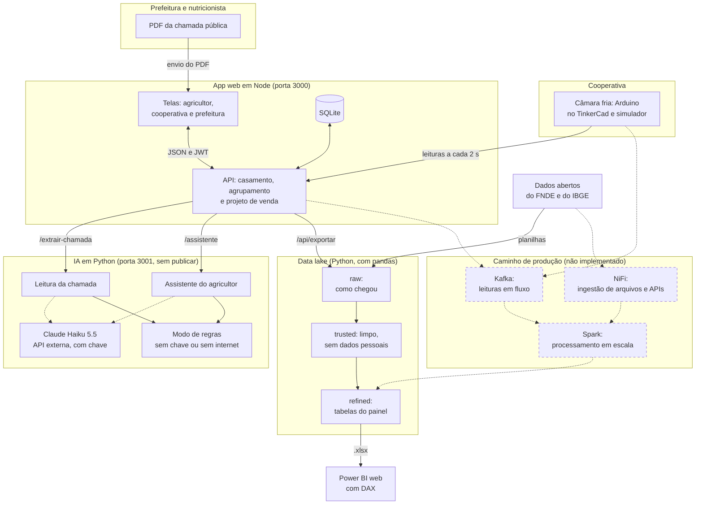
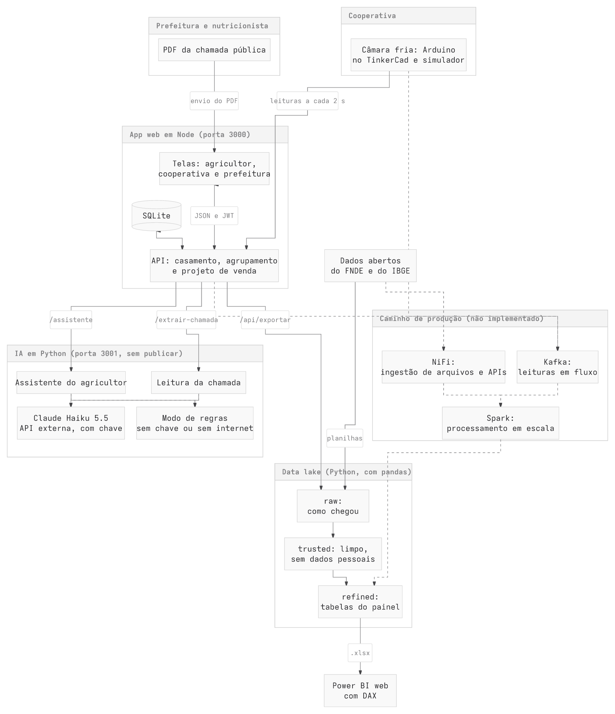

# Arquitetura

O diagrama mostra os módulos, como eles conversam e por onde passam os dados pessoais. É o diagrama da seção de arquitetura do white paper, com duas diferenças: o caminho de produção (Kafka, NiFi e Spark) está desenhado e marcado como **não implementado**, e os módulos mostram a porta, com os rótulos mais curtos e quebrados em linhas para caber na imagem.

Versão em imagem, para o PDF de evidências:

Linhas cheias são o que roda no MVP. As linhas tracejadas até o Claude são a chamada opcional à API, que só existe com a chave. O bloco tracejado do caminho de produção (Kafka, NiFi e Spark) é o que **não está implementado**.

## Módulos

| Módulo | Pasta | Tecnologia | Porta | Como sobe |
|:--|:--|:--|:--|:--|
| App (API e telas) | `app/` | Node 24 com o módulo `http` nativo, SQLite (`node:sqlite`), telas em Svelte 5 com Vite | 3000 | `npm start`, ou `docker compose up --build` |
| IA | `ia/` | Python 3.12 ou mais novo, `http.server`, SDK `anthropic`, `pypdf` | 3001, sem publicar no Docker | `python -m ia.servidor`, ou o Compose |
| Data lake | `dados/` | Python, pandas e openpyxl | sem porta | `python -m dados.pipeline tudo`, ou o perfil `tarefas` do Compose |
| Câmara fria | `iot/` | Arduino Uno no TinkerCad (`iot/camara-fria/camara-fria.ino`) e simulador em Python, só com a biblioteca padrão | sem porta | `python3 iot/simulador.py` |
| Regras compartilhadas | `compartilhado/` | JSON com o catálogo de produtos e as regras do PNAE, lidos pelo app e pela IA | não se aplica | não se aplica |

## Contratos entre os módulos

| De → para | Chamada | O que vai e o que volta |
|:--|:--|:--|
| Telas → API do app | JSON por HTTP | O login devolve um token JWT, válido por 8 horas. Sem login, 401; com o papel errado, 403. |
| App → IA | `POST /extrair-chamada` | Vai o PDF em base64 (até 10 MB) ou o texto. Volta a chamada (prazos, documentos, critérios e itens), a origem (`ia` ou `regras`) e os avisos. |
| App → IA | `POST /assistente` | Vão a chamada, o perfil do agricultor e as mensagens. Do perfil vão só os produtos e as quantidades, os meses de safra, o município, a UF, se a produção é orgânica e se há prioridade no RITS (sim ou não). Dado pessoal no pedido devolve 400. |
| IA → Claude | API da Anthropic | O PDF vai como documento, e a resposta vem num esquema JSON fixo. Sem chave, com erro, demora ou recusa, vale o modo de regras. |
| Câmara fria → app | `POST /api/leituras` | A cada 2 s (no Arduino) ou no intervalo do simulador: dispositivo, temperatura, peso e porta, com a chave do dispositivo. Leitura inválida devolve 400; leitura válida devolve 201 com os alertas que ela pede. |
| App → data lake | `GET /api/exportar` | Agricultores, chamadas, propostas, entregas e leituras, com a chave de serviço. Os agricultores saem só com pseudônimo: sem nome, CPF, CAF nem e-mail. |
| FNDE e IBGE → data lake | arquivos | Planilhas, repasses e municípios, com uma cópia versionada para rodar sem internet. |
| Data lake → Power BI | planilha `.xlsx` | Uma aba por tabela do painel. |

## Caminho de produção (não implementado)

Kafka, NiFi e Spark estão no diagrama para mostrar onde a ingestão entraria em escala. **Nenhum deles está no código.** No MVP, o pipeline em Python (`dados/`) faz esse caminho com os arquivos públicos, a exportação do app e um histórico simulado.

## Onde os dados pessoais param

- Os dados cadastrados do agricultor (nome, CPF, CAF, e-mail, telefone, dados bancários e os critérios do RITS) nunca vão para a IA. Do perfil vão só os produtos e as quantidades, os meses de safra, o município, a UF, se a produção é orgânica e se há prioridade no RITS (sim ou não).
- No chat do assistente, o serviço recusa (erro 400) CPF, e-mail, telefone e dados bancários digitados. Um nome digitado não dá para detectar, e por isso a tela pede para não escrever o nome.
- O data lake recebe os agricultores só com pseudônimo (12 caracteres, HMAC-SHA256 do id).
- Os segredos (`ANTHROPIC_API_KEY`, `JWT_SEGREDO`, `CHAVE_SERVICO` e `CHAVE_DISPOSITIVO`) ficam só no `.env`, fora do Git.

A seção Privacidade do README traz a mesma regra.
