<!--
Fonte do PDF de evidências. Gere o PDF com: bash entrega/gerar-pdf.sh
Os caminhos são relativos à pasta entrega/. Um bloco com incluir="arquivo" recebe o conteúdo do arquivo na hora de
gerar o PDF, e uma imagem que ainda não existe vira um quadro "A preencher pelo grupo" (veja pdf/filtro.lua).
-->

# A solução

::: nota
**Sobre este PDF.** Ele reúne a solução, a arquitetura e as evidências das quatro áreas do edital, na ordem dos critérios de cada área. Os prints do app foram tirados em 19/11/2026, com o app rodando localmente, sem Docker, com os usuários de demonstração e `DATA_REFERENCIA=2026-07-15` (a data em que a chamada real de Catalão ainda estava aberta; o README explica). As saídas de comando são cópias de arquivos do repositório, citados pelo caminho.
:::

## O problema

O Programa Nacional de Alimentação Escolar (PNAE) compra a merenda das escolas públicas e atendeu cerca de 38 milhões de alunos em 2025. Desde 1º de janeiro de 2026, a lei manda comprar da agricultura familiar pelo menos 45% da verba federal do programa (Lei 15.226/2025); até 2025 eram 30%. Mesmo assim, muitas prefeituras não chegam ao mínimo: em 2022, 1.531 prefeituras ficaram abaixo dos 30% da época, e faltaram R$ 97,1 milhões para elas chegarem lá. Com a regra de 45%, faltariam R$ 244,8 milhões. São contas do grupo sobre as planilhas do FNDE, com dados preliminares, e o pipeline da seção 4 refaz essas contas.

Do lado de quem planta, o agricultor muitas vezes não fica sabendo da chamada pública, não entende o edital em PDF, não sabe montar o projeto de venda ou produz pouco para o volume pedido. A cooperativa divide o pedido à mão, e a prefeitura só descobre se cumpriu o mínimo quando o ano fecha.

## O cidadão

| Quem | Hoje | Com o Colhe |
|:--------------------------|:----------------------------------|:----------------------------------------|
| **Agricultor familiar** (o cidadão principal) | não fica sabendo da chamada, não entende o edital em PDF e não monta o projeto de venda | vê no celular as chamadas que pode atender e quanto pode ganhar; o assistente explica o edital em frases curtas, com o botão "Ouvir" |
| **Cooperativa da cidade** | divide o pedido entre os cooperados à mão e controla o limite de R$ 40 mil por ano de cada um | o app divide cada item, respeita o limite e gera o projeto de venda; a câmara fria avisa quando esquenta |
| **Prefeitura** (secretaria de educação, nutricionista e Conselho de Alimentação Escolar) | confere à mão os itens, as quantidades e os preços da chamada e só sabe se cumpriu o mínimo quando o ano fecha | a IA lê o PDF da chamada; a tela mostra a meta do ano; o painel mostra quanto faltou, em reais |
| **Alunos** | pouco alimento da própria região na merenda | comida fresca, do sítio do vizinho |

## O que o MVP faz

- a **prefeitura** envia o PDF da chamada pública, e a IA (Claude) lê os itens, as quantidades, os preços e os prazos;
- o **agricultor** vê as chamadas que pode atender e quanto pode ganhar, e um assistente explica o edital em linguagem simples;
- a **cooperativa** junta os vizinhos para fechar o volume pedido e gera o projeto de venda no modelo do FNDE;
- uma **câmara fria simulada** (Arduino no TinkerCad e simulador em Python) avisa quando a temperatura ou a porta saem do normal;
- um **painel no Power BI** mostra, com dados reais do FNDE até 2022, quais prefeituras ficaram abaixo do mínimo e quanto faltou.

As chamadas públicas e os dados do FNDE e do IBGE são reais. Os usuários de demonstração, a câmara fria e o histórico de entregas da cooperativa são simulados.

## ODS

| ODS | Como o projeto contribui |
|:------------------------------|:----------------------------------------------------------------------|
| **2. Fome zero e agricultura sustentável** | mais renda para a agricultura familiar e alimento fresco na merenda; a câmara fria ajuda a perder menos comida |
| **4. Educação de qualidade** | a merenda faz parte da escola, e o PNAE atendeu cerca de 38 milhões de alunos em 2025; o projeto quer levar a eles alimento fresco da região |
| **10. Redução das desigualdades** | o pequeno produtor entra na venda pública; a divisão prioriza mulheres, jovens, assentados, indígenas e quilombolas, como o RITS, e o botão "Ouvir" inclui quem lê pouco |

## Onde está cada evidência

| Área e critério do edital | Seção | Arquivos no repositório |
|:------------------------------------|:----------|:------------------------------------------------------|
| IA: IA aplicada | 3.1 | `ia/extrair/`, `ia/assistente/` |
| IA: prompts e automação | 3.2 | `ia/prompts/`, `docs/prompts.md` |
| IA: demonstração | 3.3 | `entrega/saidas/extracao-ia-catalao.json` |
| IA: lógica e ganho | 3.4 | `ia/avaliacao/resultados/resultados.md` |
| Big Data: estrutura dos dados | 4.1 | `dados/datalake/README.md` |
| Big Data: ingestão e processamento | 4.2 | `dados/pipeline.py`, `entrega/saidas/pipeline.txt` |
| Big Data: dashboard | 4.3 | `dados/powerbi/guia-do-painel.md`, `entrega/prints/powerbi-1.png` e `powerbi-2.png` |
| Big Data: funções analíticas | 4.4 | `dados/powerbi/medidas.dax` |
| MVP: protótipo | 5.1 | `app/`, `entrega/prints/` |
| MVP: IoT | 5.2 | `iot/`, `entrega/saidas/simulador.txt` |
| MVP: fluxo funcional | 5.3 | `entrega/prints/` |
| MVP: arquitetura | 2 e 5.4 | `docs/arquitetura.md`, `docs/arquitetura.png` |
| DevOps: organização | 6.1 | `devops/evidencias/git-log.txt` |
| DevOps: Docker e CI/CD | 6.2 | `docker-compose.yml`, `devops/smoke.sh`, `Jenkinsfile`, `devops/evidencias/` |
| DevOps: segurança | 6.3 | `devops/seguranca.md`, `devops/evidencias/seguranca.txt` |
| DevOps: testes | 6.4 | `devops/plano-de-testes.md`, `devops/evidencias/testes.txt` |

# Arquitetura

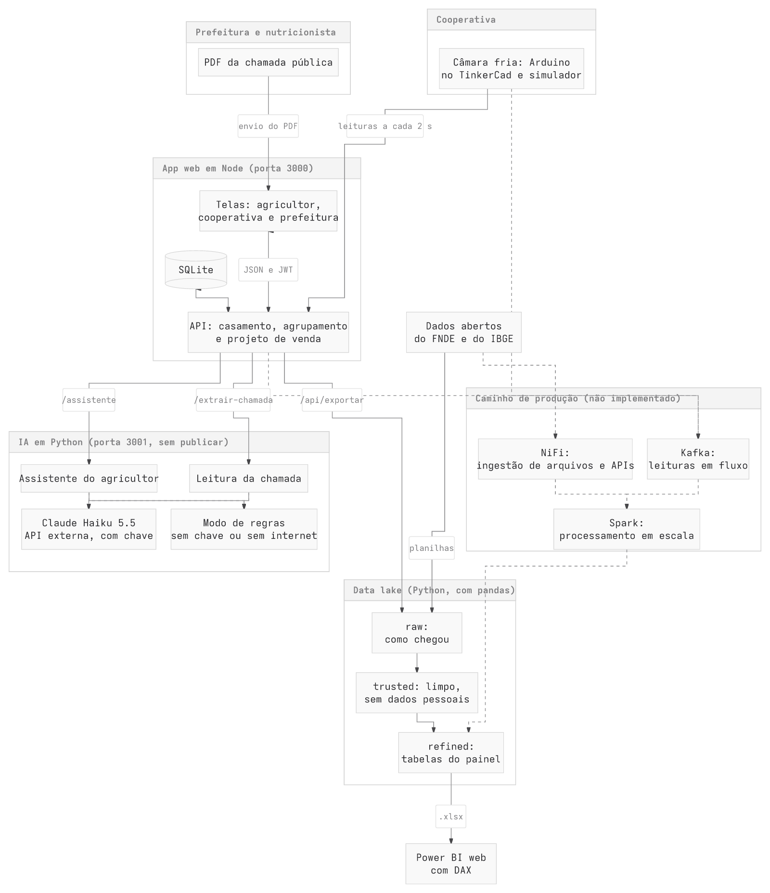{width=165mm}

São quatro módulos num repositório só, com contratos simples (HTTP em JSON e arquivos). Cada um roda sozinho, seguindo o README.

| Módulo | Pasta | Tecnologia | Porta |
|:--------------------|:------------|:----------------------------------------|:----------------------------|
| App (API e telas) | `app/` | Node 24, módulo `http` nativo, SQLite, telas em Svelte 5 com Vite | 3000 |
| IA | `ia/` | Python, `http.server`, SDK `anthropic` e `pypdf` | 3001, só na rede interna do Docker |
| Data lake | `dados/` | Python, pandas e openpyxl | sem porta (tarefa) |
| Câmara fria | `iot/` | Arduino Uno no TinkerCad e simulador em Python | sem porta (tarefa) |

**Como as áreas se ligam:**

- o app chama a IA para ler o PDF da chamada (`POST /extrair-chamada`) e para o assistente (`POST /assistente`), sem mandar dado pessoal;
- a câmara fria (o Arduino ou o simulador) manda as leituras para o app (`POST /api/leituras`), que dispara os alertas;
- o pipeline de dados lê a exportação do app (`GET /api/exportar`, com pseudônimo no lugar do agricultor) e junta com os dados públicos do FNDE e do IBGE. Assim, as leituras da câmara fria e as entregas registradas no app chegam ao painel do Power BI;
- o catálogo de produtos e as regras do PNAE (`compartilhado/`) são os mesmos no app, na IA e no data lake.

Os contratos entre os módulos estão em `docs/arquitetura.md`. Svelte 5 e Vite, nas telas, são a exceção declarada do grupo, fora do conteúdo do curso, como o README explica.

# IA e automação (4 pontos)

## IA aplicada (1,5 ponto)

A IA resolve duas partes do problema:

1. **Leitura da chamada.** A prefeitura envia o PDF do edital. O Claude Haiku 5.5 (`claude-haiku-5-5`), pela API da Anthropic, lê o edital inteiro, com as tabelas e os anexos, e devolve os dados num formato JSON fixo: número, órgão, município, UF, datas, local de entrega, documentos, critérios de prioridade e os itens, com unidade, quantidade e preço. A tela mostra a leitura como rascunho; a prefeitura confere, corrige se precisar e publica.
2. **Assistente do agricultor.** Na tela da chamada, o assistente explica o que a chamada pede em frases curtas, sugere quanto oferecer (a quantidade por semana vezes as semanas de entrega, sem passar do pedido) e lista os documentos. O botão "Ouvir" lê a resposta em voz alta.

Sem a chave da API, ou se a IA falhar, recusar ou demorar, o sistema usa o **modo de regras**, em Python, com `pypdf` e regras "se… então", e a resposta sempre diz a origem (`ia` ou `regras`).


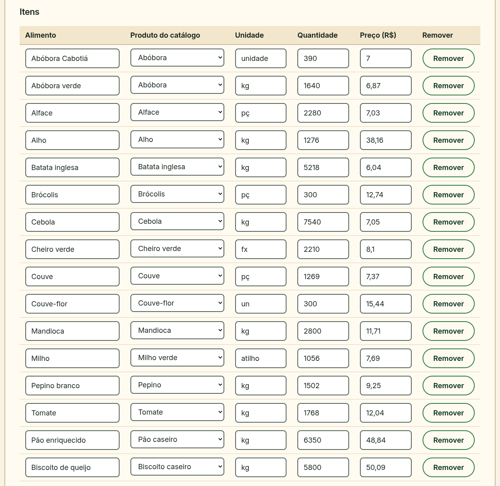

{width=95mm}

## Prompts e automação (1 ponto)

Os dois prompts do produto, na íntegra (arquivos de `ia/prompts/`, também em `docs/prompts.md`).

**Leitura da chamada** (`ia/prompts/extrair-chamada.md`), usado por `ia/extrair/claude.py`: modelo `claude-haiku-5-5`, esforço `medium`, até 16.000 tokens de saída e a resposta presa ao esquema JSON de `ia/extrair/esquema.py`.

```{.text incluir="../ia/prompts/extrair-chamada.md"}
```

**Assistente do agricultor** (`ia/prompts/assistente.md`), usado por `ia/assistente/servico.py`: esforço `low` e a resposta também presa a um esquema JSON, com o texto e a sugestão de quantidades.

```{.text incluir="../ia/prompts/assistente.md"}
```

**A automação em volta da IA:**

| Regra | Onde está |
|:--------------------------------------------------------------|:--------------------------------------|
| Sem a chave, com erro da API, tempo esgotado, resposta cortada ou recusa (`stop_reason` igual a `refusal`), vale o modo de regras, e a resposta diz a origem | `ia/extrair/servico.py` e `ia/assistente/servico.py` |
| A IA não recebe nome, CPF, CAF, e-mail, telefone, dados bancários nem os critérios do RITS. Do perfil vão só os produtos e as quantidades, os meses de safra, o município, a UF, se a produção é orgânica e se há prioridade (sim ou não) | `app/src/perfil-ia.js` e `ia/privacidade.py` |
| No chat, o app barra CPF, CAF e e-mail digitados antes de chamar a IA, e o serviço da IA barra também telefone e dados bancários (erro 400) | `app/src/rotas/agricultor.js`, `ia/privacidade.py` e o print 8 (seção 6.3) |
| O `produto_id` de cada item vem do catálogo de produtos, não da IA | `ia/catalogo.py` |
| Casamento: em quais chamadas o agricultor pode vender e quanto ganha (mesma UF, produto que ele planta, a capacidade dele e o limite de R$ 40 mil por ano) | `app/src/casamento.js` |
| Agrupamento: divide cada item entre os cooperados, com o teto de cada um, partes iguais e a sobra pela prioridade do RITS | `app/src/agrupamento.js` |

As regras de casamento e de agrupamento, passo a passo, estão em `docs/prompts.md`.

## Demonstração: entrada e saída (0,5 ponto)

**Entrada:** o edital real da chamada pública nº 003/2026 de Catalão (GO), um PDF de 15 páginas (`ia/avaliacao/chamadas/04-go-catalao-2026.pdf`). Trecho da tabela de itens da página 2, com as descrições cortadas (…) e os valores como estão no PDF:

```text
  1   Abóbora Cabotiá: de boa qualidade, firme e …   Unidade   390     R$ 7,00   R$ 2.730,00
  2   Abóbora verde: de boa qualidade, firme e …     Kg        1.640   R$ 6,87   R$ 11.266,80
```

**Saída:** a resposta que o app devolveu à tela da prefeitura na leitura dos prints 2 e 3 (`POST /api/prefeitura/chamadas`), gravada em `entrega/saidas/extracao-ia-catalao.json`, sem o número do rascunho e com a origem no topo. Trecho, com os dados da chamada e os 3 primeiros dos 16 itens:

```{.json incluir="saidas/extracao-ia-catalao.json" linhas="1-65"}
```

O que mostrar: `"origem": "ia"` com o modelo `claude-haiku-5-5`; 19 s de leitura (`duracao_ms`); o início do recebimento (09/07/2026) e o prazo (30/07/2026) como datas; os 6 documentos e os 8 critérios do edital; e o valor total de cada item. No modo de regras, sem a chave, a mesma chamada sai com os 16 itens, a quantidade e o preço, mas sem a data de abertura, o período, o local, os documentos e os critérios, e sem o valor total das duas abóboras (veja o README, na seção "IA: a leitura da chamada sem chave").

## Lógica e ganho (1 ponto)

**Como funciona:**

1. O app manda o PDF, em base64 e com até 10 MB, para o serviço da IA (`POST /extrair-chamada`).
2. Com a chave, o serviço manda o PDF inteiro para o Claude, com o prompt da seção 3.2 e o esquema JSON da chamada. Sem a chave, ou se a IA falhar, o modo de regras extrai o texto com `pypdf` e procura a tabela de itens.
3. O resultado passa pelo catálogo (o `produto_id` de cada item) e volta ao app com a origem e o tempo.
4. O app grava a leitura como rascunho. A prefeitura confere com o edital e publica, e o casamento passa a mostrar a chamada a quem planta os itens.

**O que melhora, medido.** A avaliação (`ia/avaliacao/`) leu 8 editais reais do PNAE, de 5 estados (228 itens no total), nos dois modos, e comparou cada leitura com um gabarito montado a partir do texto do PDF. O modo de regras é o "antes", sem IA; o modo IA é o "depois":

| Medida | Antes: regras | Depois: IA |
|:--------------------------------------------|-------------------:|-----------------------------------:|
| Itens corretos (o produto, a quantidade e o preço certos) | 56,1% | 95,6% |
| Quantidade e preço certos (sem olhar o nome do produto) | 61,4% | 100,0% |
| Prazo de envio certo | 37,5% (3 de 8) | 100,0% (8 de 8) |
| Tempo médio por edital | 1,4 s | 27,6 s |
| Custo medido | nenhum | US$ 0,6369 nos 8 editais (cerca de US$ 0,08 por edital; US$ 0,007 no de Catalão) |

::: nota
**Uma rodada só (n = 1).** Cada edital foi lido uma vez em cada modo, em 19/11/2026. O modo de regras dá sempre o mesmo resultado, mas a IA pode variar de uma execução para outra (os itens, o tempo e os tokens). Não há média de várias rodadas nem intervalo de confiança: os números da IA são uma amostra, não uma garantia. Os gabaritos foram montados e conferidos por agentes de IA, como `ia/avaliacao/README.md` explica.
:::

A tabela completa, com a coluna "Quantidade e preço certos" e o custo de cada edital, é a de `ia/avaliacao/resultados/resultados.md` (o comando `python -m ia.avaliacao.rodar --recontar` refaz as contas sem chamar a API):

::: {.tabela-larga incluir="../ia/avaliacao/resultados/resultados.md"}
:::

# Big Data e visualização (4 pontos)

## Estrutura dos dados (1 ponto)

O data lake (`dados/datalake/`) tem três camadas:

| Camada | O que guarda | Formato |
|:------------|:----------------------------------------------------------|:------------------------------|
| **raw** | os dados como chegaram: as planilhas do FNDE de compra da agricultura familiar (2018 a 2022), os repasses do PNAE (2009 a 2026), os municípios do IBGE, a exportação do app e o histórico simulado da cooperativa | `.xlsx`, `.txt.gz` e `.json` |
| **trusted** | os dados limpos e conferidos: nomes e tipos de coluna certos, código IBGE conferido com a UF, esfera (municipal ou estadual), percentual recalculado e o agricultor só com pseudônimo | CSV: `pnae_af`, `repasses`, `municipios`, `agricultores`, `entregas` e `leituras` |
| **refined** | as tabelas do painel, num modelo estrela | CSV e `merenda_do_vizinho.xlsx`, com uma aba por tabela |

**O modelo do painel (estrela):**

- **fatos:** `fato_pnae_af` (repasse, compra da agricultura familiar, percentual, mínimo do ano e quanto faltou, por entidade e ano), `fato_repasse_uf` (a verba mínima de cada UF, de 2023 a 2026), `fato_entregas` (as entregas, o valor, se foi no prazo e se foi a primeira venda) e `fato_camara_fria` (a temperatura e os minutos fora da faixa, por hora);
- **dimensões:** `dim_municipio` (os 5.571 municípios, com UF, região e regiões imediata e intermediária) e `dim_produto` (os 45 produtos do catálogo);
- **no Power BI:** mais duas tabelas calculadas, `dim_ano` e `dim_uf`, e seis relações muitos para um (`dados/powerbi/README.md`).

As colunas de cada tabela estão em `dados/datalake/README.md`.

## Ingestão e processamento (1 ponto)

O pipeline (`python -m dados.pipeline tudo`) faz o caminho da coleta ao dado tratado em cinco etapas:

1. **baixar-fontes:** baixa as planilhas públicas, ou usa a cópia versionada, com `PIPELINE_OFFLINE=1`;
2. **ingerir-app:** pede a exportação do app (`GET /api/exportar`, com a chave de serviço) e a grava em `raw/app/`;
3. **gerar-simulado:** gera o histórico simulado de uma cooperativa de Catalão (25 agricultores, 12 escolas, 12 meses e uma leitura da câmara fria por hora);
4. **tratar:** do raw ao trusted (limpeza, tipos, código IBGE conferido com a UF, esfera e percentual recalculado; o agricultor chega do app só com o pseudônimo, e nome, CPF, CAF e e-mail não passam);
5. **refinar:** do trusted ao refined (as seis tabelas do painel e o `.xlsx`).

Saída de uma execução de 19/11/2026, com o app no ar: a exportação do app, com os dados da demonstração dos prints, entra no raw.

```{.text incluir="saidas/pipeline.txt"}
```

O caminho de produção, com Kafka, NiFi e Spark, está no diagrama da seção 2 e **não** está implementado: no MVP, este pipeline em Python faz o mesmo caminho.

## Dashboard (1,5 ponto)

O painel é montado no Power BI web, a partir de `refined/merenda_do_vizinho.xlsx`, seguindo `dados/powerbi/guia-do-painel.md`. Tem duas páginas:

- **Página 1, PNAE no Brasil.** Filtros de ano e de UF (e, se o grupo montou, de região e de faixa de cumprimento). Cinco indicadores em cartões (o percentual comprado da agricultura familiar, o mínimo do ano, as prefeituras abaixo do mínimo, quanto faltou para o mínimo e quanto faltaria com 45%), mais um cartão com o aviso dos dados (preliminares ou parciais). Um gráfico com quanto faltou em cada UF. **Ajuda a decidir** onde levar o serviço primeiro: as UFs e as prefeituras em que mais dinheiro do PNAE deixou de chegar à agricultura familiar.
- **Página 2, Cooperativa.** Filtro de produto. Indicadores: entregas no prazo, valor entregue e minutos fora da faixa na câmara fria (e, se o grupo montou, kg entregues, renda por agricultor e agricultores na primeira venda). **Ajuda a decidir** quais produtos e entregas a cooperativa precisa acompanhar e quando a câmara fria pede atenção.

Para conferir a página 1, com o ano 2022: 44,5% comprado da agricultura familiar, 1.531 prefeituras abaixo dos 30%, R$ 97,1 milhões que faltaram para o mínimo e R$ 244,8 milhões que faltariam com 45%. São os números que o teste `test_numeros_de_referencia_de_2022` do pipeline confere.

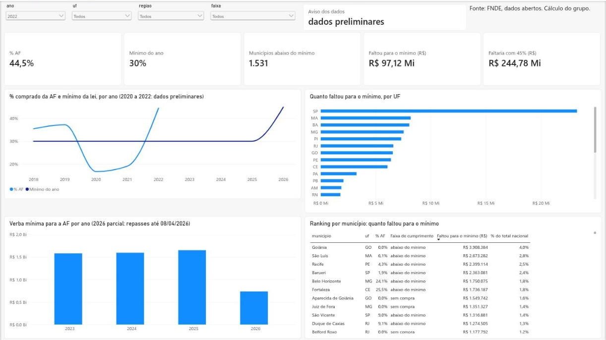

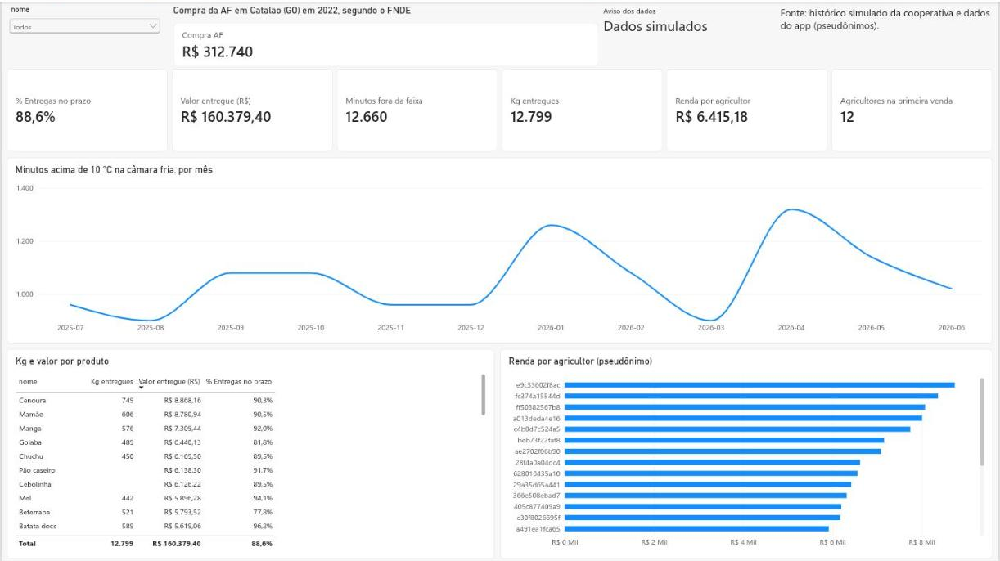

## Funções analíticas (0,5 ponto)

As medidas do painel são escritas em DAX, em `dados/powerbi/medidas.dax`: 2 tabelas calculadas, 1 coluna calculada e 17 medidas, cada uma com um comentário que explica o porquê. Elas usam `CALCULATE`, `KEEPFILTERS`, `FILTER`, `ALL`, `VALUES`, `DIVIDE`, `SUMX`, `DISTINCTCOUNT`, `VAR`/`RETURN`, `IF`, `SWITCH(TRUE(), ...)`, `ISBLANK` e `ISEMPTY`. O arquivo inteiro:

```{.text incluir="../dados/powerbi/medidas.dax"}
```

# MVP, IoT e experiência digital (4 pontos)

## Protótipo (1 ponto)

O app web tem 7 telas funcionais, em português simples, com letra de pelo menos 18 px, contraste alto e o botão "Ouvir" nos textos principais. Os prints de cada tela estão nesta seção e nas seções 3, 5.3 e 6.3:

| Tela | Quem usa | O que faz | Prints |
|:------------------|:--------------|:------------------------------------------------------|:--------------|
| Entrar | todos | entrar ou criar uma conta | 1 |
| Prefeitura | prefeitura | ler o PDF com a IA, conferir, publicar e acompanhar as propostas, as entregas e a meta do ano | 2, 3, 4 e 12 |
| Agricultor | agricultor | as chamadas abertas para ele, com quanto pode ganhar, e o cadastro do sítio | 5 e 13 |
| Chamada | agricultor | o resumo da chamada, o assistente, os documentos e o que ele quer vender | 6, 7 e 8 |
| Cooperativa | cooperativa | a proposta conjunta: a divisão de cada item entre os cooperados, que dá para editar | 9 |
| Projeto de venda | cooperativa | o projeto de venda no modelo do FNDE, para imprimir | 10 |
| Câmara fria | cooperativa | as leituras ao vivo, os alertas e o registro das entregas | 11 e 14 |

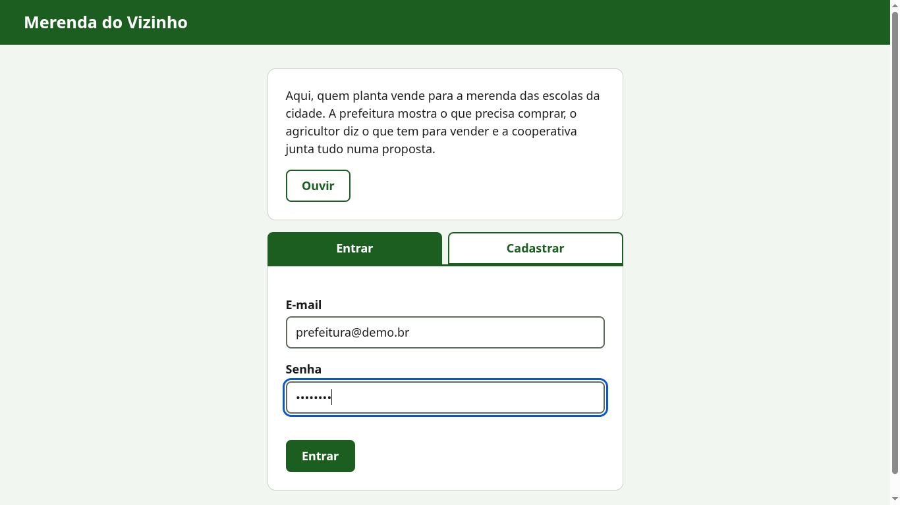

**Telas responsivas.** O app funciona no celular, no tablet e no computador, sem app nativo. Na largura de 375 px, as duas telas abaixo não rolam para o lado: `document.documentElement.scrollWidth <= window.innerWidth` deu `true` nas duas.

::: lado-a-lado
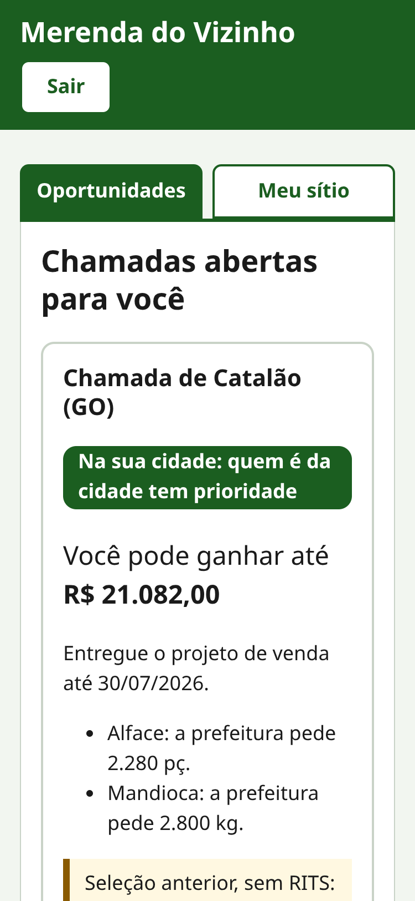

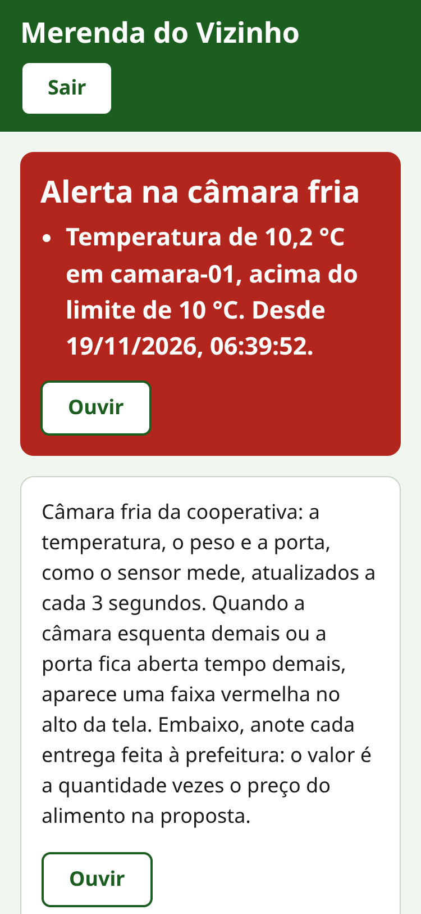
:::

## IoT (1 ponto)

A câmara fria da cooperativa é simulada de dois jeitos, com o mesmo formato de leitura:

- **Arduino Uno no TinkerCad** (`iot/camara-fria/camara-fria.ino` e `iot/camara-fria/ligacoes.md`), com **três sensores**: temperatura (TMP36, no pino A0), peso (um potenciômetro no lugar do sensor de peso, no A1) e porta (uma chave deslizante, no D2). O LED (D13) e o buzzer (D8) formam o alarme, que liga com a temperatura acima de 10 °C ou com a porta aberta por mais de 2 minutos. A cada 2 s, o Monitor Serial mostra uma linha JSON, como `{"dispositivo":"camara-01","temperatura_c":6.4,"peso_kg":182.0,"porta_aberta":false}`.
- **Simulador em Python** (`iot/simulador.py`, só com a biblioteca padrão), que manda as leituras para a API do app (`POST /api/leituras`, com a chave do dispositivo), nos cenários `normal`, `porta-aberta`, `entrega` e `colheita`.

**Link do projeto no TinkerCad:** <https://www.tinkercad.com/things/7p2YmcBCG4E-camara-fria-pnae?sharecode=wPjrXlihhXMCQCk6bQZHyF2sJ6PP0AdU33NmhdCIkd4>

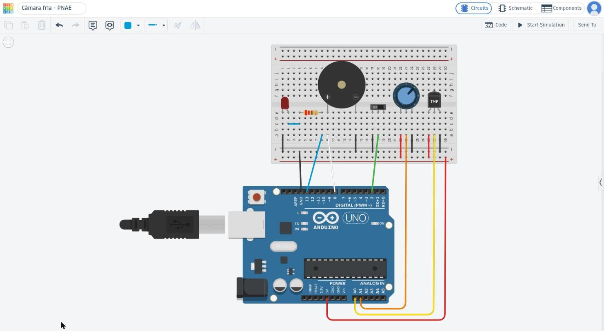

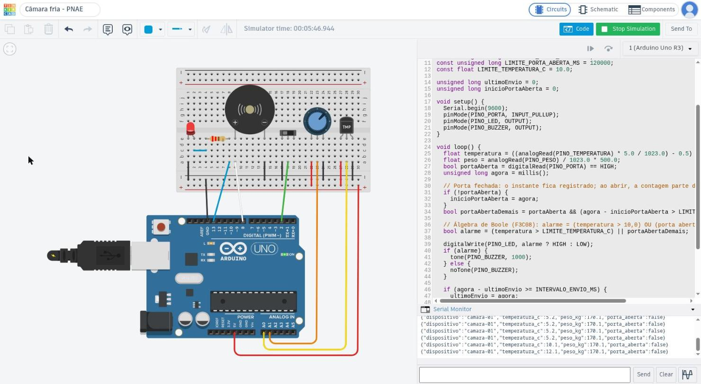

Saída do simulador no cenário de porta aberta, com 15 leituras, uma por segundo: a temperatura sobe 0,4 °C por leitura e passa de 10 °C na 14ª. Cada linha começa com a resposta da API (201: leitura aceita).

```{.text incluir="saidas/simulador.txt"}
```

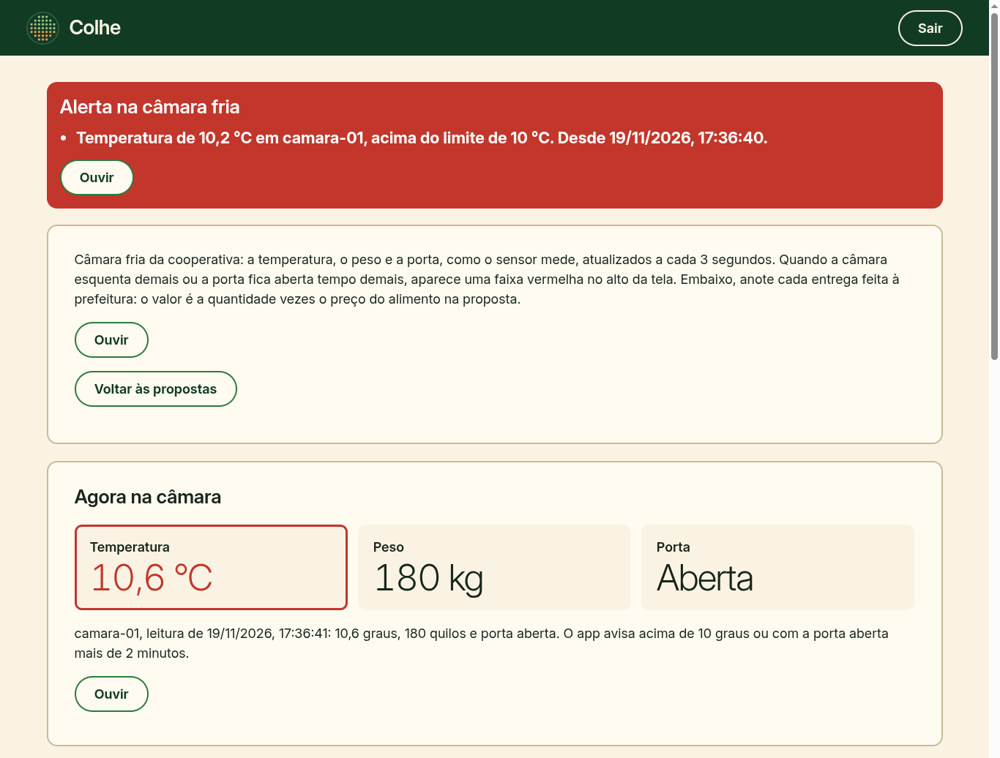

## Fluxo funcional, do início ao fim (1 ponto)

Um uso completo, com os usuários de demonstração e a chamada real de Catalão (GO):

1. **A prefeitura publica a chamada.** Ela envia o PDF do edital, a IA lê (prints 2 e 3, na seção 3.1), ela confere e publica. A chamada 003/2026 publicada, com os 16 itens, é a do print 4: no app de demonstração ela já vem publicada de antes, e a tela a marca como "Leitura já conferida antes (cache)". A leitura que a IA fez na hora é a dos prints 2 e 3.
2. **A agricultora acha a oportunidade.** A Ana entra e vê a chamada da cidade dela, com quanto pode ganhar: até R$ 21.082,00 (print 5).
3. **O assistente ajuda a decidir.** Ela pergunta se pode entregar 50 de alface por semana, e a resposta faz a conta (print 6, na seção 3.1) e preenche o campo. Ela toca em "Quero participar", e o interesse vai para a cooperativa (print 7).
4. **A cooperativa monta a proposta.** O app divide cada item entre os cooperados que plantam, respeitando o que cada um produz e o limite de R$ 40 mil por ano. O que se conta em unidade (a alface em pç, o maço, a dúzia) sai em números inteiros, e o kg segue com centésimos. A divisão aparece pronta, do jeito que o app a calcula, sem edição (print 9); a cooperativa pode mudá-la e salvar, e o app confere de novo.
5. **O projeto de venda sai pronto.** "Gerar projeto de venda" preenche o modelo do FNDE com cada agricultor, os itens e os valores; o que o app não guarda fica em branco, para escrever à mão (print 10).
6. **A câmara fria guarda os alimentos.** As leituras chegam a cada segundo, e quando a temperatura passa de 10 °C a faixa vermelha avisa (print 11, na seção 5.2).
7. **A entrega é registrada, e a prefeitura acompanha.** A cooperativa registra a entrega de 300 kg de mandioca (R$ 3.513,00). A prefeitura vê a proposta recebida, a entrega e quanto falta para a meta do ano (print 12).


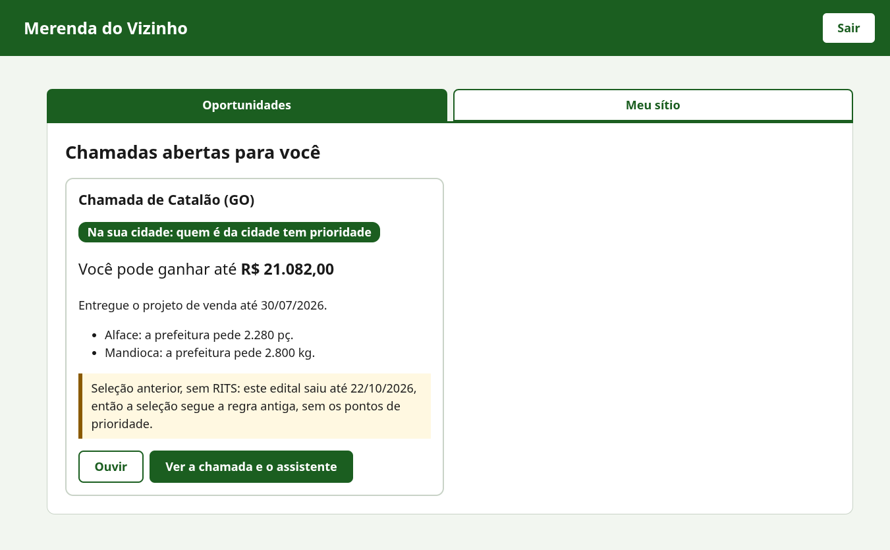

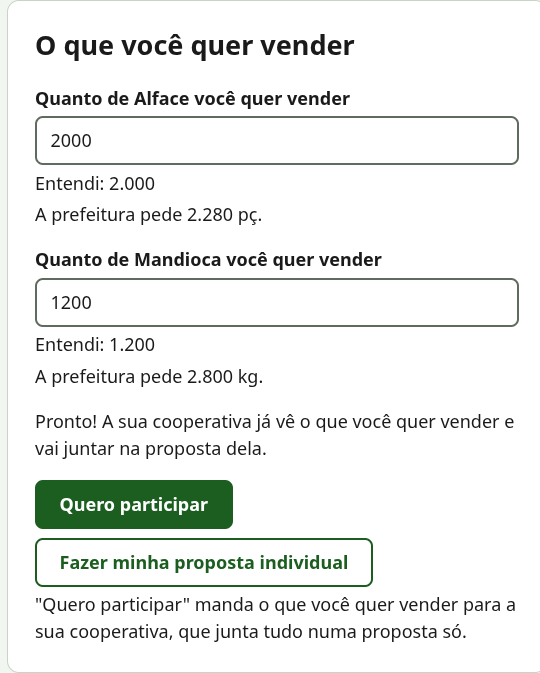{width=95mm}


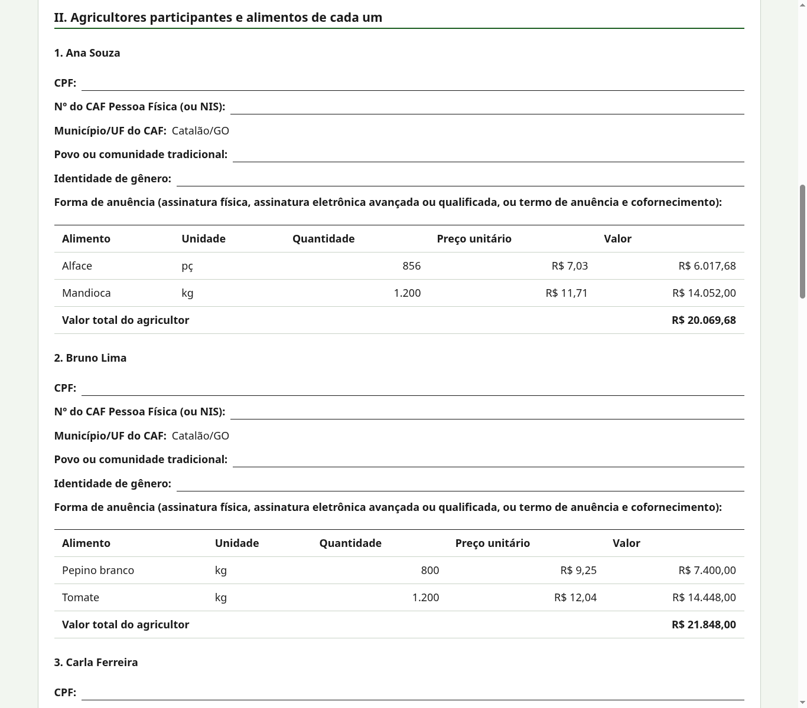


## Arquitetura (1 ponto)

O diagrama da arquitetura geral, com as quatro áreas e como elas se ligam, é o mesmo da seção 2 (`docs/arquitetura.png`), repetido aqui. A versão em Mermaid, os módulos, os contratos e o caminho de produção estão em `docs/arquitetura.md`.

{width=165mm}

# DevOps, segurança e qualidade (3 pontos)

## Organização (0,5 ponto)

O repositório é organizado por módulo, um por área:

| Pasta | O que tem |
|:--------------------|:--------------------------------------------------------------------------------|
| `app/` | o app web: a API em Node (`src/`), as telas em Svelte (`web/`) e os testes (`test/`) |
| `ia/` | o serviço da IA, os prompts, a avaliação e os testes |
| `dados/` | o pipeline do data lake, o painel (o guia e o DAX) e os testes |
| `iot/` | o sketch do Arduino, as ligações, o simulador e os testes |
| `compartilhado/` | o catálogo de produtos e as regras do PNAE, usados pelo app, pela IA e pelo data lake |
| `devops/` | o smoke, o Jenkins, o plano de testes, a segurança e as evidências |
| `docs/` | a arquitetura, os prompts, o canvas, o roteiro do pitch e as fontes |
| `entrega/` | este PDF, o `grupo.txt`, os prints e os scripts que geram o PDF e o `.zip` |

Tudo é versionado com Git: commits pequenos, com mensagens em português no formato `tipo(área): descrição`, um ramo por trilha de trabalho e merges na integração. O `.zip` traz a pasta `.git`, com o histórico completo. O histórico, como o `gerar-pdf.sh` grava em `devops/evidencias/git-log.txt`:

```{.text incluir="../devops/evidencias/git-log.txt"}
```

## DevOps (1 ponto)

**Docker.** O `docker-compose.yml` sobe o app e a IA, com healthcheck nos dois; a IA fica só na rede interna, sem porta publicada. O pipeline de dados e o simulador rodam como tarefas (perfil `tarefas`). As quatro imagens rodam com um usuário sem privilégios (uid 1000).

**Teste de fumaça.** O `devops/smoke.sh` sobe a pilha num projeto próprio, confere o app e a IA, faz uma pergunta ao assistente como a Ana (o app chama a IA e a resposta volta), manda 5 leituras do simulador, roda o pipeline e derruba tudo. Trecho de `devops/evidencias/smoke.txt` (o build das imagens e o resumo do pipeline foram omitidos):

```{.text incluir="../devops/evidencias/smoke.txt" comeca="$ ;== ;200 ;201 ;NAME ;merenda-smoke-final-app-1 ;merenda-smoke-final-ia-1 ;SMOKE OK"}
```

**Integração contínua no Jenkins.** O `Jenkinsfile` roda sozinho a cada commit, sem passo manual: o Jenkins confere o repositório a cada 2 minutos e roda seis etapas, o checkout, os testes do app (Node 24), os testes de Python (IA, dados e IoT, no Python 3.12), o build das quatro imagens, o smoke e o arquivamento das evidências. O Jenkins local sobe com `devops/jenkins/docker-compose.yml` (passo a passo em `devops/jenkins/README.md`).


## Segurança (0,5 ponto)

Três práticas, cada uma com evidência (`devops/seguranca.md` explica cada comando):

1. **Autenticação e autorização:** a senha é guardada com scrypt; o login devolve um token JWT (HS256, válido por 8 horas); sem login, 401; com o papel errado, 403. A câmara fria usa uma chave de dispositivo, e a exportação para o data lake, uma chave de serviço.
2. **Validação de entrada:** CPF com os dígitos verificadores, e-mail, UF, datas, números e as faixas físicas da câmara fria, com erro 400 e a mensagem em português; JSON quebrado dá 400, e um envio acima de 256 KB dá 413.
3. **Proteção de dados (LGPD):** o CPF e o CAF aparecem mascarados; a IA não recebe os dados cadastrados, e o chat barra dado pessoal digitado (print 8); o data lake recebe o agricultor só com pseudônimo; os segredos ficam só no `.env`, fora do Git, do `.zip` e das imagens do Docker.

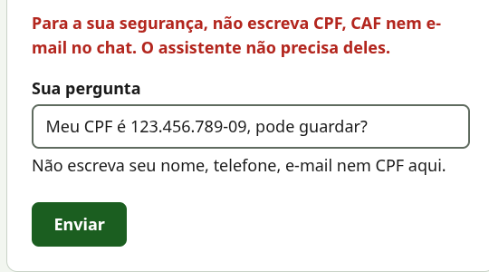{width=95mm}

A saída dos comandos, em `devops/evidencias/seguranca.txt`:

```{.text incluir="../devops/evidencias/seguranca.txt"}
```

## Testes (1 ponto)

**O plano de testes** (`devops/plano-de-testes.md`) tem 15 casos, cada um com objetivo, passos, resultado esperado, resultado obtido, evidência e o teste automatizado que o confere:

| Caso | O que confere | Resultado |
|:----------|:----------------------------------------------------------------------------|:--------------|
| CT01 | login errado, rota sem token e token falso devolvem 401 | passou |
| CT02 | papel errado devolve 403 | passou |
| CT03 | CPF inválido no cadastro do agricultor devolve 400 | passou |
| CT04 | o CPF e o CAF aparecem mascarados | passou |
| CT05 | sem a chave da Anthropic, a IA lê a chamada pelas regras | passou |
| CT06 | a chamada aparece para quem produz o item e some para quem não produz | passou |
| CT07 | a proposta conjunta nunca passa do pedido, da capacidade nem do limite anual | passou |
| CT08 | o projeto de venda tem os totais certos | passou |
| CT09 | leitura inválida da câmara fria devolve 400, e calor ou porta aberta geram alerta | passou |
| CT10 | o pipeline gera as três camadas, com os números do FNDE e sem dado pessoal | passou |
| CT11 | a exportação para o data lake exige a chave de serviço e não leva dado pessoal | passou |
| CT12 | a IA não recebe os dados cadastrados, e o chat barra dado pessoal digitado | passou |
| CT13 | envio grande demais devolve 413, e JSON quebrado devolve 400 | passou |
| CT14 | teste de fumaça com o Docker Compose | passou |
| CT15 | pipeline de ponta a ponta no Jenkins | passou |

**A execução:** 260 testes automatizados, todos passando: 131 no app (`node --test`), 87 na IA, 27 nos dados e 15 no simulador (`unittest`). Nenhum chama a API da Anthropic. Resumo de `devops/evidencias/testes.txt`, que traz a saída completa, teste a teste:

```{.text incluir="../devops/evidencias/testes.txt" comeca="# ;$ ;ℹ tests;ℹ pass;ℹ fail;Ran ;OK;FAILED;(código de saída"}
```

# Uso de IA generativa

O grupo declara o uso de IA generativa no README, na seção "Uso de IA generativa", como o edital pede:

- **na construção do projeto:** o Claude Code, com o Claude Fable 5.2 no planejamento, o Haiku 5.5 nas tarefas simples, o Opus 5.5 nas tarefas médias e grandes e o Sonnet 5.5 nas revisões de cada tarefa;
- **dentro do produto:** o Claude Haiku 5.5, pela API da Anthropic, na leitura da chamada e no assistente (seção 3), com o modo de regras quando não há chave ou a IA falha.
